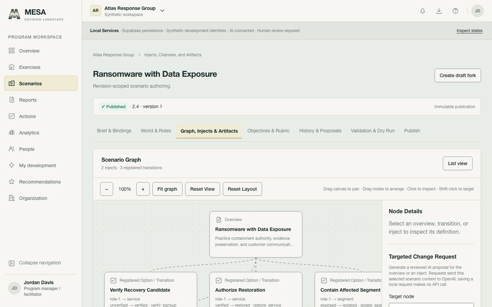
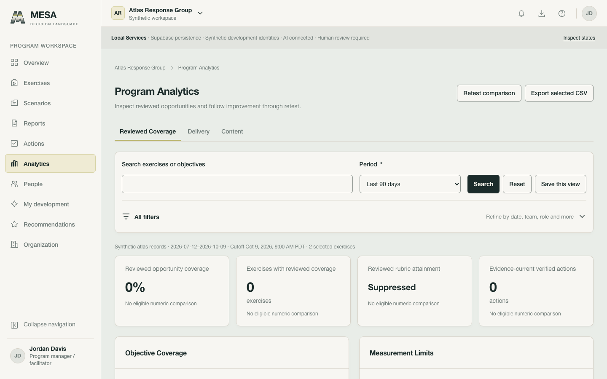
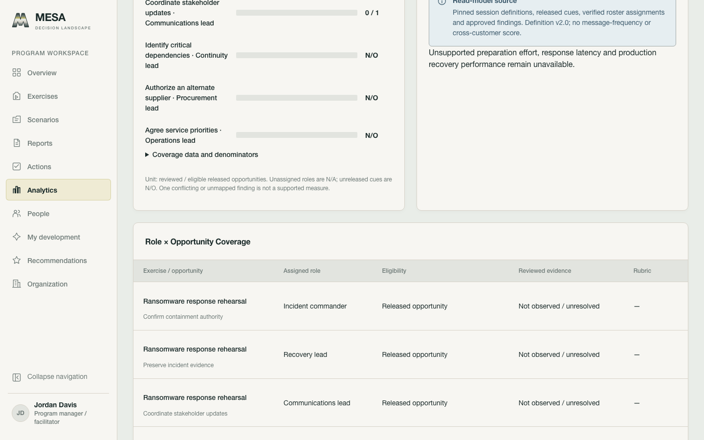
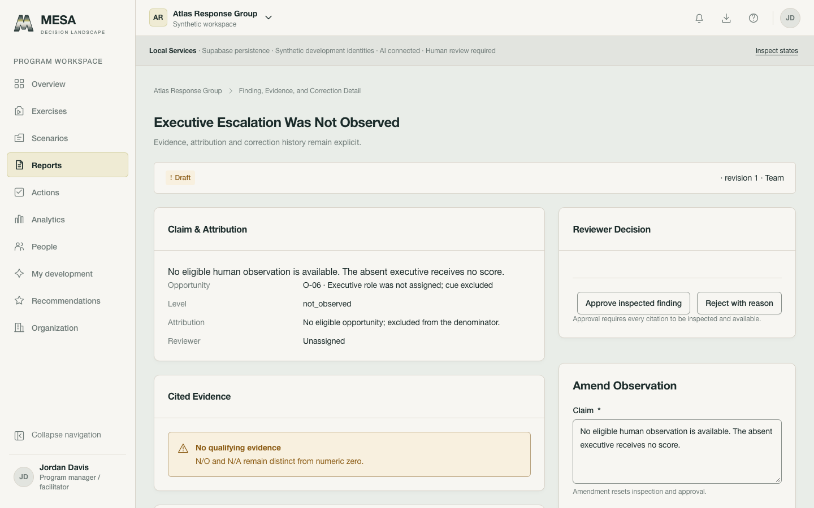

# MESA — Decision Landscape

Local readiness-exercise harness. A facilitator authors a versioned scenario, runs a pinned session, and can publish a report only after a person inspects the evidence. Generated text stays a proposal until that person accepts it.

This repository is a **local development prototype** (`strata-readiness-ui` 0.2.0, `"private": true`). It is not a production readiness platform, it has no public deployment, and it has no measured users. Synthetic organizations are Atlas Response Group and Harbor Continuity Group. User-facing chrome says MESA. Storage keys, the npm package name, and several contracts still say STRATA.

## Product

The exercised domain is operational rehearsal: incident response, disaster recovery, business continuity, and crisis management. The engineering subject is the loop around that domain.

1. Fork or edit a scenario whose actions come from a registered set.
2. Inspect that scenario as a graph. The graph is a projection of the definition. Dragging a node stores a layout preference and does not create a branch.
3. Schedule an exercise. Launch pins the definition.
4. Facilitate the session: stepped time, cue release, command receipts, decisions, and notes.
5. Review findings. Approval requires inspected citations. `not_observed` and `not_applicable` are not numeric zero.
6. Publish a snapshot. Later corrections become amendments. The published snapshot is not edited in place.
7. Read program analytics that withhold a number when the cohort, evidence, or comparison conditions do not support one.

Screens for sign-in, invitations, billing, entitlements, and external export exist as routes. Their actions say the service is unavailable.

## Product surfaces

These four screens are the core of the local Atlas fixture, captured November 13, 2026 from `npm run dev` at http://127.0.0.1:3000. The banner is the development harness (local services, synthetic identities, human review). The records are fixtures, not a customer workspace.

The scenario graph projects a published definition. Solid arrows are recorded conditions. Dashed lines group nodes under the overview and do not set execution order. Dragging a node stores layout only.



Program analytics can show a percent only for reviewed opportunities over eligible released ones. Rubric attainment stays **Suppressed** when the cohort, evidence, or comparison conditions do not support a score.



The same selection is a role-by-opportunity table. Unreleased cues and missing reviews stay "Not observed / unresolved" instead of a zero.



A finding with no eligible observation cannot be approved. N/O and N/A stay distinct from numeric zero, and the approve action states that every citation has to be inspected.



## Stack

| Layer | Choice |
| --- | --- |
| UI host | Next.js 15 App Router, React 19, TypeScript `strict` |
| Product screens | HTML string renderers painted into React shells through `html-react-parser` |
| Marketing site | React components and `app/(marketing)/marketing.css` |
| Domain | Framework-agnostic TypeScript in `src/`, compiled with `tsc` to `dist/` for the API |
| API | Next.js Route Handlers calling `backend/api.mjs` on the same local process |
| Database | Local Supabase / PostgreSQL. One versioned JSON aggregate per organization, plus AI proposal and run tables |
| AI | Server-side OpenAI Responses with strict JSON schema. Optional. Human accept or reject |
| Tests | Node's test runner via `tsx`, importing `src/` directly |

There is no TanStack Table, TanStack Query, or client data cache. Tables, filters, and saved views are implemented in the domain modules and string renderers.

## Architecture

```
Browser
  app/MesaHost.tsx
    React shells and screen registry
    src/session-controller.ts  routing, forms, commands, paint
    src/views-*.ts             HTML for most screens
  HttpAdapter
    POST /api/bootstrap | /api/read | /api/command | /api/ai/*
Next.js Route Handler (app/api/[...path]/route.ts)
  backend/api.mjs
    origin check, CSRF cookie, synthetic persona scope
    Repository → local Supabase only (loopback URLs rejected)
    workflow commands and improvement rules
    OpenAI Responses (server key; structured output; human accept)
```

A consequential edit is a command with an expected version and an idempotency key. The server checks scope, runs the domain handler, and compare-and-swaps the workspace. The receipt status is `submitted`, `accepted`, `executed`, `rejected`, or `unknown`. Accepted is not executed. An unknown outcome is reconciled against the original command id.

`src/routes.ts` registers 70 screens with requirement, shell, and dependency ids. Registration is not a finished backend for every screen.

## Engineering and design decisions

**String renderers behind a React host.** Domain modules stay importable from Node tests, and the product keeps one CSS system (`design-tokens.css`, `app.css`). Shells and a few home states are React. Most screen bodies are still strings. `src/session-controller.ts` owns orchestration and a large amount of behavior. That split is documented in [docs/engineering/MIGRATION.md](docs/engineering/MIGRATION.md) and is unfinished on purpose.

**One aggregate document.** Local Supabase stores a versioned workflow JSON per organization. That made receipts, immutability, and AI leases testable without inventing a production schema. It will not survive concurrent editors.

**Digest as a staleness check, not a signature.** `hash()` in `src/workflow-model.ts` is an FNV-1a-style 32-bit hex. Publish and AI accept compare it so a stale preview cannot commit. It is not a cryptographic signature.

**Metrics that refuse a number.** `MetricView.displayState` is `supported`, `not_observed`, `suppressed`, or `incomparable`. Unsupported states must carry a null value (`assertMetric` in `src/contracts.ts`). Coverage is reviewed opportunities over eligible released opportunities. A cohort under five, an intervention, or mixed rubrics suppresses attainment. Conflicting approved findings are not averaged (`src/improvement-model.ts`).

**Reviewed AI.** Generation does not publish, approve a finding, or verify an action. Acceptance rebuilds an ordinary authoring command and fails with 409 if the draft version or digest moved (`acceptanceCommand` in `backend/api.mjs`). Bounded automation reserves tokens in Postgres before the provider call, does not retry, and pauses on conflict. See [docs/engineering/BOUNDED-AI-SPEC.md](docs/engineering/BOUNDED-AI-SPEC.md).

**Role changes the record.** Participant and observer projections drop facilitator notes, unreleased cues, and private findings (`src/platform.ts`). Persona switching is a local harness, not authentication.

**Visual system.** Obsidian, Mist, Stone, Basalt, and Mineral Gold. Gold is emphasis, not body text and not a status color. Verification state uses an icon plus a text label. The marketing site is a separate React surface. Its hero frames and impact band are composed illustrations. Figures such as “92% exercise completion” are not computed from the analytics model and are not measured outcomes.

**Command-table lab.** `/explore/command-table` is an isolated lighting workbench (commit `0c4f194`). It is not part of the exercise product.

## More screenshots

Same capture session. The four core screens are inline above.

| Screen | File |
| --- | --- |
| Marketing home | [docs/screenshots/01-marketing-home.png](docs/screenshots/01-marketing-home.png) |
| Program overview | [docs/screenshots/02-program-overview.png](docs/screenshots/02-program-overview.png) |
| Exercise calendar | [docs/screenshots/05-exercise-calendar.png](docs/screenshots/05-exercise-calendar.png) |
| Facilitator control | [docs/screenshots/06-facilitator-control.png](docs/screenshots/06-facilitator-control.png) |
| Corrective-action table | [docs/screenshots/08-corrective-actions.png](docs/screenshots/08-corrective-actions.png) |
| Published report | [docs/screenshots/09-published-report.png](docs/screenshots/09-published-report.png) |
| Published report at 390×844 | [docs/screenshots/10-published-report-mobile.png](docs/screenshots/10-published-report-mobile.png) |
| Spatial illumination lab | [docs/screenshots/11-command-table-lab.png](docs/screenshots/11-command-table-lab.png) |

## Local setup

Requirements: Node.js 20 or newer, npm, and the [Supabase CLI](https://supabase.com/docs/guides/cli) for the database. Docker is required by local Supabase.

```sh
npm install
cp .env.example .env.local
npm run db:start
npm run dev
```

Open http://127.0.0.1:3000/ for the marketing site and http://127.0.0.1:3000/o/atlas for the Atlas workspace. `/api` is served by the same process.

Leave `OPENAI_API_KEY` empty to run without model calls. The product still loads. AI proposal buttons need a server-side key in `.env.local`. The browser never receives that key. Local Supabase credentials come from `supabase status` at runtime. Do not commit them.

```sh
npm test          # domain compile, then Node tests
npm run check     # tsc for src/ and the Next.js project
npm run build     # domain compile and next build
npm start         # production server on 127.0.0.1:3000
npm run dev:clean # same dev server with harness labels hidden
```

There is no ESLint script in `package.json`.

`npm start` hides harness labels unless `SHOW_FIXTURE_CHROME=1`.

## Maturity

Verified in this working tree on November 13, 2026:

- `npm test`: 76 passing, 0 failing.
- `npm run check`: passed (`strict` on both TypeScript projects).
- `npm run build`: passed. Next.js 15.5.29 compiled the marketing page, the product catch-all, `/api`, and `/explore/command-table`. Shared first-load JavaScript was about 103 kB.

Older notes in [docs/engineering/IMPLEMENTATION-STATUS.md](docs/engineering/IMPLEMENTATION-STATUS.md) cite 36, 69, and 70 tests at different dates. Those are historical. The command above is the current suite. Browser walkthroughs recorded in October 2026 are fixture checks, not a WCAG audit, a load test, or a production acceptance pass. PDF save was not file-inspected in that record.

Not built: authentication, multi-user concurrency, a normalized schema, virtualized large tables, realtime collaboration, signed publication, and a hosted demo.

## Publication boundary

Do not put confidential data into this harness. Persona switching is not authentication. Facilitator-only scenario text is still present in client-delivered source (`src/glasshouse.ts`).

The public GitHub history omits `Strata-Media-Docs/` and `.private/`. Those paths are third-party exercise manuals and a facilitator scenario package. They remain in the original local history and were not destroyed there. A clone of the public repository will not contain them. The running GLASSHOUSE adapter is `src/glasshouse.ts`. Details are in [agents-review.md](agents-review.md).

## Documentation

- [agents-review.md](agents-review.md) — technical assessment for engineering reviewers
- [docs/engineering/MIGRATION.md](docs/engineering/MIGRATION.md) — Next.js strangler boundary
- [docs/engineering/DESIGN-SYSTEM.md](docs/engineering/DESIGN-SYSTEM.md) — visual and interaction conventions
- [docs/engineering/LOCAL-SERVICES.md](docs/engineering/LOCAL-SERVICES.md) — database, CSRF, and key boundary
- [docs/engineering/BOUNDED-AI-SPEC.md](docs/engineering/BOUNDED-AI-SPEC.md) — what the model is allowed to do
- [docs/engineering/SCENARIO-GRAPH-SPEC.md](docs/engineering/SCENARIO-GRAPH-SPEC.md) — graph as a projection
- [docs/product/STRATA-CONCEPT.md](docs/product/STRATA-CONCEPT.md) — product specification, not a claim that the platform was validated
- [technical-due-diligence.md](technical-due-diligence.md) — November 2, 2026 architecture notes. A few host paths in the portfolio-export case study still say `web/`, which was removed in the Next.js move

## Source map

- `src/contracts.ts` — request states, command receipts, metric display states, screen shape
- `src/routes.ts` — 70-screen registry
- `src/platform.ts` — scope checks and redaction
- `src/workflow-model.ts`, `src/workflow-commands.ts` — definitions, validation, publish, session commands
- `src/improvement-model.ts`, `src/improvement-views.ts` — coverage, filters, retest comparison, analytics tables
- `src/scenario-graph.ts` — graph projection and pointer interaction
- `src/session-controller.ts` — client orchestration
- `backend/api.mjs`, `backend/repository.mjs`, `backend/ai-service.mjs` — local API, compare-and-swap, AI leases
- `app/` — Next.js host, shells, marketing site, command-table route
- `explorations/command-table/` — isolated lighting lab
- `tests/` — domain and renderer checks
