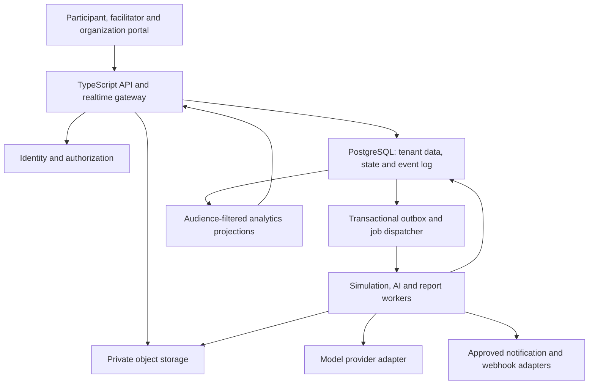

# Readiness Platform — Functional Beta PRD and Architecture

Version 0.1 • October 8, 2026 • Proposed product and engineering specification

**Decision:** Build a multi-tenant exercise and development platform that turns rehearsals into an ongoing, evidence-backed readiness program. Launch with incident response, disaster recovery, business continuity, and crisis management. Differentiate through credible adaptive simulation, portable scenarios, version-specific expert approval, accountable remediation, and participant development.

This document specifies a product to build; it does not describe an implemented or validated platform. Competitive observations derive from the accompanying Reflex product dossier and market assessment. Design choices, targets, estimates, and commercial hypotheses below are recommendations. Competitors' undocumented capabilities are not assumed absent.

## 1. Product thesis and competitive basis

**Customer promise:** Prepare a relevant exercise quickly, run a believable crisis, understand what happened, and make the next response measurably better.

The first customer should be a readiness owner or specialist consultancy with a response plan, several participating functions, and intent to repeat exercises. Prioritize MSSPs, vCISOs, IR/continuity consultancies, and lean internal security/resilience teams. Regulated and large enterprise customers are expansion opportunities whose procurement needs may extend beyond beta.

Do not position AI generation, adaptive opposition, or automatic reports as unique. Public competitor materials already establish substantial overlap. The proposed differentiation is the connected workflow and the quality of its evidence.

| Competitive signal | Adopt the useful pattern | Proposed improvement to validate |
|---|---|---|
| Reflex: contextual exercises, adaptive opponents, investigation and stakeholder pressure [1] | A scenario responds to the organization's environment and participant actions | Keep a consistent simulated world; every consequential action and finding is inspectable |
| Immersive: conversational authoring, branching, human publication control [2] | Conversational editing with dependency checks and version history | Show a semantic change preview and preserve the relationship between customization, rubrics, and expert approval |
| Cytactic and BreachRx: exercises tied to response workflows [3,4] | Reuse plans, responsibilities, and corrective actions | Close the practice → finding → owner → retest loop without building a production incident-management suite |
| Conducttr: rich simulated communications and facilitator control [5] | Role-specific inboxes, media pressure, controlled injects | Package an approachable authoring workflow and reusable discipline packs |
| ThreatGEN: an adaptive opponent operating within a game engine [6] | Explicit actions, state, constraints, and consequences | Combine enforceable rules with natural-language investigation and stakeholder dialogue |
| TryHackMe: fast customization and low-friction participation [7] | Saved organization context, guests, editable content | Bound guest access and minimize repeated setup across client organizations |
| Ally: facilitator support and recurring client delivery [8] | Treat expert facilitators and service partners as first-class users | Explicit delegated access, client-specific portals, and reviewed participant development |
| ChaosTrack and Tabletop.ai: accessible exercise UX, reporting and action tracking [9,10] | Simple participation and useful executive summaries | Trace every assessment to evidence; separate observed behavior from inference |
| CISA templates and internal facilitation [11] | Transparent structure and exportable exercise materials | Make portability a product feature rather than using content lock-in as retention |

**Strategic bet:** Customers will renew for trusted improvements, reusable content, and lower delivery effort. Famous names may help discovery, but expert-reviewed content must deliver demonstrable instructional value. Validate both propositions in paid pilots.

## 2. Product boundaries and taxonomy

IR, DR, continuity, and crisis management are **exercise disciplines**, not industry verticals. Tabletop is a **delivery mode**. Keep these dimensions separate in content, search, analytics, and entitlements.

| Dimension | Beta values | Extension mechanism |
|---|---|---|
| Discipline | Cyber incident response; IT disaster recovery; business continuity; crisis communications/management | Versioned discipline pack: vocabulary, actions, state definitions, objectives, rubrics, report sections |
| Industry context | Technology/SaaS, financial services, healthcare, manufacturing | Context overlays for assets, stakeholders, dependencies, and terminology; qualified review required for specialized claims |
| Delivery mode | Facilitated tabletop; hybrid AI simulation; AI-guided practice | Shared event model and assessment pipeline |
| Exercise scale | Focused role/team practice; cross-functional organization exercise | Role templates and objective selection |
| Difficulty | Foundation; practiced; advanced | Explicit resource, uncertainty, pressure, and timing settings |
| Content provenance | Platform-authored; tenant-authored; expert-authored/reviewed/endorsed | Versioned attribution and rights records |

Industry overlays adapt generic content. They do not certify sector-specific compliance. Beta ships all four disciplines; depth begins with IR plus DR, followed by continuity and communications on the same engine.

**Beta is functional when a customer can independently** create an organization, invite people, select or import a scenario, customize and validate it, run and recover an exercise, review an AAR, publish scoped reports, assign corrective actions, update development profiles, and conduct a comparable retest. Expert review and license-controlled catalog distribution must also work end to end.

Out of beta: live production cyber response, offensive actions against real systems, autonomous production changes, full technical cyber ranges, disconnected deployment, unrestricted third-party code/plugins, open marketplace payouts, public employee rankings, automatic cross-customer performance benchmarking, and meeting bots that attend external calls. These are not dependencies for the specified exercise experience.

## 3. Personas and access model

Accounts may belong to multiple organizations. Identity is global; access and exercise evidence are tenant-local. A consultant must explicitly switch organization context. Partner hierarchy is a billing/relationship structure, not an implicit right to read client data.

| Role | Main capabilities | Important restriction |
|---|---|---|
| Organization owner | Membership, policies, delegated partner grants, subscription, branding | Administrative ownership does not automatically grant detailed personal coaching access |
| Program manager | Exercise calendar, team analytics, published reports, remediation | Personal-detail access requires a specific coaching grant |
| Scenario author | Create, customize, validate, submit content | Cannot self-assert another person's endorsement |
| Facilitator | Run assigned sessions; inject, pause, adjudicate; review findings | Exercise-scoped access; no access to unrelated client sessions |
| Participant | Join assigned sessions, submit actions, review own evidence and development plan | Cannot see hidden scenario state, other participants' private notes, or answer keys |
| Observer | View specifically allowed exercise feeds/reports | No participant scoring and no action authority by default |
| Coach | Review explicitly assigned participant profiles and plans | No tenant-wide individual browsing by default |
| Expert reviewer/publisher | Review a content revision and approve an attribution scope | No customer telemetry or participant data by default |
| Platform operator | Operational support through audited, time-limited support grants | No standing ability to impersonate a participant or silently read content |

A user can hold several roles. Authorization evaluates tenant, resource, assignment, audience, and action; it is not only a role-name check. Separately scope restricted report sections, legal-team communications, and personal observations.

Guests use a verified, revocable invitation bound to a single exercise and role. Link possession alone is insufficient for sensitive exercises. Guest participation may later be claimed into a profile after identity verification; never merge people solely by display name.

## 4. Core journeys

### 4.1 Organization onboarding and customization

1. Create organization, choose a program owner, set participant privacy defaults, and invite administrators.
2. Build a reusable context profile: critical services, assets, vendors, teams, escalation paths, business constraints, recovery targets, timezone, and terminology.
3. Upload plans or source materials. Extract into a draft fact sheet with source references; users accept, correct, or exclude facts. Untrusted documents are data, never instructions to platform agents.
4. Select a scenario from the catalog or start from a discipline template. Set objectives, duration, roles, difficulty, communication channels, and observed capabilities.
5. Apply organization parameters and ask for changes in plain language. Show the affected narrative, state, dependencies, injects, rubrics, and expected consequences before saving.
6. Validate references, reachable objectives, available roles, timing, licensing, audience visibility, and unsupported actions. Run a machine-assisted rehearsal and facilitator preview.
7. Publish an immutable revision and schedule a session. The session pins the content, rubric, engine, and policy revisions.

Reusing accepted organization context should be the default. Each fact records sensitivity, source, review date, and validity period. Old vendor/role information is flagged, not silently reused forever. Beta accepts manual facts and uploaded documents; automated external OSINT collection is a later opt-in extension.

Customization operates on a fork. Tenant facts must never modify a shared catalog original or become training material for another customer. Undo restores a prior draft; publishing a new version never mutates a running exercise.

### 4.2 Exercise experience

Participant workspace: role brief, situation feed, simulated inbox, evidence drawer, action/investigation console, decision log, and shared team workspace. Simulated communications are clearly labeled. Participants can ask questions in natural language, inspect available artifacts, communicate with allowed actors, and submit structured actions or decisions.

Facilitator workspace: hidden world state, learning-objective coverage, actor decisions, queued injects, elapsed wall and simulation time, participant connection status, pacing controls, adjudication queue, and emergency pause.

The beta supports text-first exercise delivery alongside a customer's existing meeting. Important verbal decisions must be recorded by participants or captured as attributed facilitator observations. Uncaptured speech is **unobserved**, not a failure. Recording/transcription is not silently assumed; automated external-meeting attendance is outside beta.

Before starting, confirm participant consent/disclosure for AI assessment, role assignments, visibility, duration, objectives, and whether competitive pressure is enabled. AI-guided sessions still designate a human owner who can stop the exercise.

Select **practice** or **assessment** purpose separately from delivery mode. Practice allows coaching and adaptive difficulty; assisted observations are labeled and excluded from unassisted proficiency comparisons. Assessment pins difficulty and adaptation rules, disables unsolicited coaching, and compares only compatible opportunities. Facilitator intervention remains possible but may invalidate affected measures rather than penalizing participants.

### 4.3 Review, remediation, and development

End exercise → generate draft timeline and findings → facilitator reviews evidence and attribution → participants can flag corrections → reviewer approves scoped reports → portal publishes approved versions → findings become owned actions → targeted practice is scheduled → retest compares comparable observations.

An action has an owner, due date, source finding, acceptance evidence, status, and optional verification exercise. Marking a ticket complete is not the same as demonstrating improved readiness. Track **implemented** and **verified in retest** separately.

## 5. Scenario Library and Expert Editions

Use a single catalog with two recognizable experiences:

- **Scenario Library:** searchable generic scenarios, organization forks, and reusable components. Filter by discipline, industry, role, skill, duration, maturity, and language.
- **Expert Editions:** identifiable specialists or recognized public figures who authored, reviewed, or endorsed specific scenario revisions. Each listing explains the person's relevant expertise, their actual contribution, approval scope, and date.

Do not collapse these into one ambiguous “approved” badge. “Authored by,” “reviewed by,” and “endorsed by” are different claims. Celebrity participation without relevant professional expertise must be presented accurately. No simulated likeness, voice, name use, or implied endorsement without explicit rights.

**Approval workflow:** invite reviewer → verify identity and credentials/biography → record consent and commercial rights → provide full content and rubric preview → capture requested changes → approve exact content hash and declared safe parameter schema → countersign publication → monitor expiration/revocation. Content author and reviewer must be separate for a “reviewed” claim.

An approval binds the signed template revision plus any expressly approved parameter substitutions. Custom changes outside that scope remove the active approval badge; preserve “derived from” provenance without implying approval of the derivative. A publisher revocation stops new distribution and removes current approval display, while retaining a historical record of what was approved when a past session ran.

Catalog cards show objective, audience, prerequisites, expected duration, mode, content revision, preview, accessibility notes, review status, license, export rights, and included versus paid entitlement. Preview excludes hidden injects and answer keys for participants.

**Beta content target:** 12 runnable generic packs, three per discipline, plus at least two genuinely reviewed Expert Editions if launch agreements are secured. The approval/distribution workflow is required regardless. If no experts have approved content, launch no approved-content claims and treat Expert Editions content availability as an unmet commercial launch gate.

| Discipline | Initial scenario seeds |
|---|---|
| IR | Ransomware with data exposure; compromised identity/cloud account; supplier-origin breach |
| DR | Regional service loss; backup integrity failure; destructive change with dependent-service restoration |
| Continuity | Critical supplier outage; loss of a major operating site; staff shortage with demand surge |
| Crisis management | Public allegations/data leak; product-safety incident; conflicting media and stakeholder narratives |

Beta commerce uses curated publication, explicit entitlements, invoices or managed subscriptions, and manually administered publisher agreements. Self-service payouts, auctions, and a public creator social network are unnecessary for beta.

## 6. Private organization portal and recommendations

Each organization receives an authenticated, branded landing page at `/o/{slug}`. A slug is a locator, never an authorization mechanism. Search engines receive no private content. Custom domains can follow beta.

| Portal area | What it shows | Visibility rule |
|---|---|---|
| Readiness overview | Latest approved recap, upcoming sessions, due actions, objective coverage | Only records the viewer can access |
| Reports | Approved executive, team, and technical AARs with version history | Report and section-level audience filtering |
| People | Role directory and permitted participant development cards | Directory metadata separate from private coaching observations |
| My development | Own prior roles, observed strengths, improvement targets, practice plan | Participant and explicitly assigned coaches |
| Program analytics | Trends, gaps, role coverage, remediation and retest status | Program permission; suppress small-cohort aggregates |
| Recommended practice | Relevant scenarios, expert content, and optional services | Separate learning recommendations from paid promotions |

Recommendation inputs: organization-selected objectives, disciplines, industry tags, recent approved team findings, unresolved actions, role-coverage gaps, prior scenario exposure, and entitlement. Do not use private individual weaknesses to target sales.

Beta recommendation order is explainable and rules-based: filter on rights and access → exclude completed/recently repeated content unless a retest is due → match approved program needs → prioritize prerequisite fit and available duration → diversify disciplines. Show a reason such as “Supports your open recovery-validation action.” Commercial placement is clearly labeled and cannot masquerade as an assessment conclusion.

Admin controls: turn promotions off, choose allowed offer categories, dismiss/feedback, and approve any sales-contact request. No participant profiles, raw transcripts, or customer facts go to publishers or sales partners. Measure recommendation usefulness separately from purchase conversion.

## 7. Participant readiness profiles

A profile is a record of **observed exercise behavior and development**, not a universal competence score or personality judgment.

Required fields: tenant-local person ID, chosen display details, exercised roles, exercise history, objective opportunities, strengths with evidence, targeted improvements, confidence/coverage labels, personal goals, assigned practice, coached feedback, corrected observations, and retest outcomes.

Examples: “Demonstrated escalation clarity in two observed incident-commander exercises” and “Practice validating restore integrity before service release.” Avoid labels such as “poor leader” or assertions about motives.

Each observation stores exercise/role/context, rubric revision, evidence references, attribution basis, reviewer, review status, visibility, and participant correction status. AI stand-ins have separate synthetic identities and never add observations to the absent human's profile.

Tenant administrators configure a transparent policy before participation. Default: participants see their own details; facilitators see assigned-session evidence; explicitly designated coaches see assigned development profiles; program managers receive team trends. Changes to visibility are audited and disclosed. Small cohorts below five are suppressed in aggregate people comparisons; permitted exercise reports remain available to their authorized audience.

Cross-tenant continuity is an optional **participant-controlled passport export**, not automatic profile merging. The participant can share approved, export-permitted summaries; tenant confidential details and third-party identities are excluded. A receiving organization treats imported claims as external credentials, separate from its own observations. Beta supports export; federated profile synchronization is later.

## 8. Analytics, assessment, and reporting

### 8.1 Measurement contract

Before publication, each scenario declares objectives, observable opportunities, expected roles, acceptable actions, timing windows, evidence requirements, scoring anchors, and exclusions. Adaptation may change the path; it cannot secretly move scoring criteria.

| Metric | Beta definition | Interpretation constraint |
|---|---|---|
| Objective coverage | Observed eligible opportunities / planned applicable opportunities | Explains whether an exercise actually tested the intended skills |
| Decision timeliness | Simulation time from a qualifying cue's delivery to a valid recorded response | Show delivery/connection failures; do not blame a person for an undelivered cue |
| Escalation quality | Rubric-based presence of recipient, severity, evidence, and requested decision | Assess the decision artifact, not message count |
| Recovery target performance | Simulated recovery time and simulated recoverable-data age versus scenario targets | Does not verify production RTO/RPO achievement |
| Coordination | Explicit ownership, acknowledged handoffs, and unresolved conflicting decisions | Speech volume and speed alone are not coordination |
| Communication quality | Consistency, known/unknown distinction, audience fit, approval path | Qualified human review for consequential interpretations |
| Action follow-through | Due/implemented/overdue/verified actions and time to closure | Implementation and demonstrated effectiveness are distinct |
| Development trend | Comparable reviewed observations by skill, role, and scenario difficulty | Do not combine incompatible rubrics into a false trend |

Use rubric levels 0–3: not demonstrated, partially demonstrated, demonstrated, and demonstrated under the stated additional challenge. **Not observed** and **not applicable** are separate nonnumeric states. Only score zero where there was a valid opportunity, adequate access, and evidence supporting that conclusion.

For a supported objective summary, calculate `100 × Σ(weight × level/3) / Σ(eligible observed weights)`. Always display observation coverage beside the result. Suppress a summary if coverage is below the scenario's declared threshold (default 70%). Raw observations and scope remain available. Team findings are not automatically assigned to individuals.

Beta confidence labels describe evidence quality—direct recorded action, corroborated observation, or inference needing review—not fabricated calibrated probabilities. No cross-customer percentiles at launch. Retests show scenario/rubric changes; compare stable anchors and flag practice effects.

### 8.2 Analytics suite

Provide organization/program dashboards, exercise drill-down, event timeline, objective/role coverage matrix, action aging, retest comparison, personal-development trends, facilitator operations, content performance, and platform cost/reliability telemetry. Every aggregate links to authorized underlying evidence and states its denominator.

Filters: date, discipline, industry pack, team, role, scenario family/revision, difficulty, facilitator, and review status. Saved views and CSV export are beta requirements. Business analytics use reviewed data by default; tentative AI findings appear only in draft review views.

### 8.3 Report workflow

Report variants: executive summary; full AAR; technical timeline; corrective-action plan; participant development report; framework-mapping appendix when a pack supplies reviewed mappings.

Required AAR content: objectives and scope, participant/role list, scenario/revision, key decisions and timestamps, positive behaviors, evidence-linked findings, alternative actions, uncertainty/limitations, corrective actions, owners/dates, and suggested retest. Simulated facts and real organizational facts must remain distinguishable.

Generate a concise executive layer with drill-down; report length is not a success metric. Beta outputs: accessible in-app HTML, PDF, DOCX, CSV metrics/action exports, and structured report JSON. Export rendering runs from a pinned, audience-filtered report snapshot, not from an unrestricted document later hidden with CSS.

Lifecycle: `draft → in_review → approved → published → superseded/withdrawn`. Approval names the reviewer and audience. Amendments create a new version and preserve the prior decision record. Participant corrections update approved derived artifacts through this workflow; no silent overwriting.

NIST/other framework mappings are versioned content references, not proof of compliance, legal privilege, or production readiness.

## 9. Beta requirements and acceptance criteria

All P0 items below are beta release requirements. P1 is explicitly deferred.

| ID | Priority | Requirement | Acceptance evidence |
|---|---|---|---|
| TEN-01 | P0 | Tenant creation, membership, guest access, delegated partner grants | Client A cannot read, mutate, subscribe to, export, or retrieve AI context from Client B in isolation tests |
| CTX-01 | P0 | Reusable organization context and reviewed uploads | Every accepted extracted fact retains provenance; updates flag affected unpublished drafts |
| CAT-01 | P0 | Catalog, filters, previews, entitlements, generic packs | Authorized user finds and launches a licensed scenario; an unentitled user cannot fetch hidden pack content |
| EXP-01 | P0 | Expert identity, rights, revision approval, revocation | Modified derivative loses badge unless within signed parameter scope; revocation blocks new distribution |
| AUT-01 | P0 | Conversational customization, structured editor, diff, undo, validator | Broken references and invalid objective paths block publish; author sees affected rubrics |
| SIM-01 | P0 | Multiplayer text simulation, roles, investigation and actions | Complete sessions in all four disciplines, including non-cyber environment-driven crises |
| SIM-02 | P0 | Adaptive adversary/stakeholders with constrained actions | Agent cannot access hidden player data, invent resources, or bypass action preconditions |
| FAC-01 | P0 | Pause/resume, inject, adjudicate, override, replay | Crash/reconnect recovers committed state; overrides record actor, rationale, and assessment effect |
| OBS-01 | P0 | Evidence capture and reviewable assessments | Every published scored observation has valid evidence, opportunity, rubric, and human approval |
| REP-01 | P0 | Full analytics and report lifecycle/exports | Authorized exports match approved snapshot; forbidden personal sections never enter exported bytes |
| DEV-01 | P0 | Profiles, coaching grants, corrections, development plans | Participant can challenge an attribution; absent people and observers receive no competence scores |
| ACT-01 | P0 | Corrective actions and comparable retests | Action links to source finding and verification result; retest identifies incompatible measures |
| POR-01 | P0 | Private branded portal and need-based offers | User sees only authorized recaps/profiles; promotions disable cleanly and show their rationale |
| PKG-01 | P0 | Versioned JSON scenario export/import | Export/import round trip preserves executable meaning; dry-run rejects unsafe or incompatible packages |
| OPS-01 | P0 | Audit, backups, retention/deletion, monitoring, rate/budget controls | Restore drill succeeds; deletion propagates through derived stores under documented retention policy |
| INT-01 | P0 | Invitation/calendar files and controlled outbound action webhook | Signed delivery, retries and idempotency tested; no arbitrary recipient/endpoint chosen by an LLM |
| ENT-01 | P0 | Organization and content entitlement administration | Expired content cannot start new sessions; running sessions finish under launch-time entitlement |
| EXT-01 | P1 | Meeting bots, native Jira/ServiceNow integrations, SCIM, custom domains | Separately scoped after beta evidence |
| EXT-02 | P1 | Self-service publisher payouts, federated passports, vetted benchmark cohorts | Require commercial/privacy governance and sufficient usage |
| EXT-03 | P1 | Customer-dedicated deployments, additional regions, technical range connections | Enterprise expansion, not a hidden beta dependency |

## 10. Architecture overview

**Recommended shape:** TypeScript modular monolith for business domains, with separately scalable simulation/AI/report workers. PostgreSQL is authoritative for tenant data, session state, event history, and job/outbox records. Use object storage for documents and exports, a managed queue for work delivery, and WebSockets for live updates. Avoid a fleet of independently deployed domain microservices for beta.



Logical modules: identity/tenancy; organization context; content/catalog/licensing; scenario authoring; simulation runtime; assessment/evidence; reports/analytics; development/actions; portal/recommendations; integrations; audit/operations. Modules own tables and expose typed service contracts. Cross-module writes use orchestrated application services rather than uncontrolled shared-table access.

**Implementation baseline:** React/Next.js TypeScript frontend; TypeScript API (Fastify is a reasonable default); PostgreSQL; managed object storage and queue; containerized API/realtime and worker processes; managed OIDC-compatible identity with MFA; infrastructure as code; OpenTelemetry-compatible instrumentation. Pin supported versions during implementation. These are design selections, not claims that a particular framework supplies tenancy or secure simulation automatically.

Start with one commercial cloud and one declared data region, with a staging environment containing synthetic data. Select the cloud/identity provider against team familiarity, model-provider terms, and pilot procurement requirements before implementation; avoid building multi-cloud abstractions beyond storage, queue, and model adapters. Do not claim residency solely from the database region—model processing, backups, logs, and support access also matter.

## 11. Tenant isolation and security architecture

Every tenant-owned row includes `tenant_id`. Composite foreign keys include tenant identity so an exercise cannot accidentally reference another tenant's participant or artifact. Global catalog records are separately owned; customer forks reference immutable catalog revisions without exposing tenant context back to the catalog.

The API derives tenant scope from the authenticated membership or explicit delegation, never trusts a client-supplied tenant header alone, and carries scope into jobs and database transactions. PostgreSQL row-level security is a second enforcement layer. Use a non-owner application role without `BYPASSRLS`; apply and test forced policies where appropriate. Owners and privileged roles can bypass normal RLS, so migration/backup credentials must be isolated from runtime access. [12]

Use transaction-local tenant context and reset it by ending each transaction; test connection-pool reuse and missing-context failures. Apply resource/audience permissions in addition to tenant checks. RLS alone does not prevent a participant reading another participant's private profile within the same organization.

Additional boundaries:

- Object keys are tenant-scoped; downloads require fresh authorization and short-lived scoped URLs. Export jobs recheck permissions at delivery.
- Queue payloads, caches, full-text/vector retrieval, realtime topics, traces, and model conversation memory carry tenant scope. No cross-tenant conversation memory.
- Realtime subscriptions authorize each resource; authorization changes revoke active subscriptions and subsequent fetches.
- Uploaded content is scanned, size/type limited, and extracted in an isolated worker. Imported JSON never executes code, fetches arbitrary URLs, or defines shell commands.
- LLM tools expose allowlisted application commands, never SQL, broad object-store access, or general outbound network access.
- Encrypt transit and managed storage; keep credentials in a secret manager; redact sensitive log payloads; audit admin/support activity. Require MFA for staff and tenant administrators.
- Outbound webhooks use admin-approved HTTPS destinations, SSRF protections, signed payloads, minimal data, retry limits, and secret rotation.
- Document the model subprocessors, retention choices, customer-data training policy, and contract restrictions. Verify provider configurations rather than assuming “no training” implies no retention.

Data retention defaults proposed for pilots: raw exercise content 180 days; approved reports/development records 24 months; operational audit metadata 12 months. These are configurable product defaults, not legal requirements. Support deletion requests, legal-hold exceptions where applicable, export before deletion, and backup expiry disclosure. Make a tenant-wide retention choice during onboarding.

“Immutable event log” means append-only during its permitted retention, not undeletable personal data forever. Store sensitive text/identity references in separately governed payload records; purge or redact them under policy, invalidate derived reports/observations as needed, and preserve only allowed nonidentifying audit metadata. Deletion is a controlled lifecycle operation, not an ordinary event edit.

## 12. Simulation runtime and adversarial AI

### 12.1 Authoritative world model

A published scenario contains typed entities (services, assets, organizations, actors), initial state, resource constraints, role permissions, action definitions, transitions, injects, objectives, rubrics, and stop conditions. State variables may include service availability, attacker access, backup integrity, staff capacity, public confidence, and stakeholder commitments.

The deterministic engine owns state transitions. AI proposes actions or dialogue; it cannot write world state directly. Natural-language requests are parsed into a typed intent, validated, and either executed, clarified, or routed to the facilitator. Unsupported actions never silently succeed. Freeform player statements are not proof that the described action actually occurred.

Each accepted command appends an event with session sequence, expected/prior state version, simulation time, wall timestamp, actor, audience, payload reference, correlation ID, and policy/version references. Update state, append events, and write the outbox in one transaction. Snapshots accelerate recovery; the event history explains it.

Session lifecycle: `draft → scheduled → lobby → running ↔ paused → ended → review → archived`; cancellation is explicit. A running session pins its scenario and engine revision. Clock modes are real-time or facilitator-stepped; changing mode requires an audited pause. Timer consequences use persisted simulation deadlines, not a browser clock.

### 12.2 Agents and information boundaries

| Agent | Job | Allowed view and authority |
|---|---|---|
| Adversary | Pursue a plausible scenario objective, adapt to observable defensive actions | Actor-specific observations, resources, known assets, permitted actions; never facilitator secrets or evaluation answer keys |
| Stakeholder | Represent press, executive, supplier, regulator, customer, or employee pressures | Role-specific information and persona constraints; no omniscience |
| Exercise director | Maintain pacing and coverage within the published adaptation envelope | Hidden scenario and objective coverage; proposes bounded pressure/inject changes, cannot rewrite criteria |
| Assistant facilitator | Clarify rules, explain interface, surface adjudication needs | No covert advice that invalidates assessment; assistance is logged |
| Evaluator | Draft evidence-linked observations and report sections | Read-only evidence/rubric access; no power to change simulation history |

For a DR or continuity exercise without a malicious opponent, an **environment actor** models failures, dependencies, constraints, and stakeholder pressure. Do not force an attacker into every discipline.

### 12.3 Making the adversary clever and instructionally useful

Separate the **in-world opponent goal** from the **customer learning objective**. Example: attacker seeks simulated exfiltration and disruption; the customer wants to test escalation, containment authority, restoration decisions, and stakeholder communication. Winning at any cost is not the training objective.

At each decision point:

1. Assemble the actor's permitted observations and durable belief state, not the full database.
2. Identify feasible tactics/actions under resources, cooldowns, access, and current world state.
3. Generate a small set of candidate plans with expected consequences and concise rationale.
4. Apply deterministic legality checks and the director's allowed difficulty/pressure envelope.
5. Select an action using the scenario policy: plausible progress, useful uncertainty, and coverage of relevant learning opportunities.
6. Execute through the engine, reveal only appropriate consequences, and update the actor's beliefs from observations.

Pacing controls can delay an optional complication or select a harder valid path; they cannot invent secret capabilities to defeat good decisions. If participants successfully contain the adversary, that success stands. Further learning should come from credible recovery/communications tasks or a disclosed follow-on round.

Difficulty parameters include starting access, resources, response delay, ambiguity, evidence noise, concurrent pressure, and stakeholder cooperation. Changes during a session are logged and shown in the report; material changes make comparisons non-equivalent.

**Example across IR and DR:** A scenario begins with compromised identity access and a threatened customer service. If the team revokes that identity, the adversary loses it immediately. It may use a second foothold only if that foothold was already available under the scenario rules; otherwise the attack is contained. The exercise can continue with evidence preservation, backup validation, service-restoration authority, and customer communications. If participants restore an unchecked backup, the engine applies the declared integrity consequence. Reports distinguish attacker containment success from recovery-process gaps, assign observations only to people with relevant opportunities, and recommend a focused restoration retest. This creates useful pressure without making successful defense impossible.

Maintain bounded memory and model/tool budgets per session. Store model/version identifiers, prompt-template revision, inputs' evidence references, structured output, accepted/rejected action, and concise decision justification. Do not require or expose private model chain-of-thought.

### 12.4 Concurrency, failure, and replay

Use per-session state-version checks and a transactional session lock for commits. Each command has an idempotency key. Duplicate requests return the prior result; stale commands re-evaluate or receive a conflict response. Model generation happens outside the transaction, then the proposal is checked against the current state before commit.

Queue delivery is treated as at-least-once. Workers use durable job status, leases with fencing/version checks, retries, and idempotent handlers. WebSocket delivery is advisory: clients reconnect with the last seen sequence and fetch authorized missing events or a fresh filtered snapshot. Persist timers and resume overdue timers deterministically after a worker restart.

Provider failure: retry within a deadline → use a compatible configured provider if customer policy allows → use authored fallback injects/dialogue → pause with a clear facilitator notice when safe continuation is impossible. Never advance hidden state merely because a model timed out.

Replay uses recorded commands, random seed, accepted AI outputs, and pinned engine/content versions. It reproduces committed outcomes. A fresh model generation is a new branch, not deterministic replay. Facilitator corrections append a compensating event and identify observations that require re-review.

### 12.5 Evaluation gates

Build a regression corpus across all four disciplines: compliant and unconventional player choices, successful containment, failed recovery, contradictory requests, impossible actions, absent roles, adversarial uploaded instructions, and requests for private information.

Beta gates: zero accepted invalid state transitions in the deterministic test corpus; zero tenant/role data leaks in the defined authorization corpus; all published findings evidence-linked and reviewed; at least 90% reviewer agreement that sampled AI actions are plausible and relevant across at least 100 reviewed action proposals. The latter is an initial pilot target, not a measured quality claim. Track error severity and reviewer disagreement, not only aggregate pass rate.

## 13. Data model and domain contracts

| Entity group | Core records | Important invariant |
|---|---|---|
| Identity/access | User, Tenant, Membership, Delegation, Invite, CoachingGrant | Membership/delegation is explicit and revocable |
| Context | OrganizationProfile, ContextFact, SourceDocument, FactRevision | Extracted facts retain provenance and tenant scope |
| Content | ScenarioFamily, ScenarioRevision, DisciplinePack, Asset, License, Entitlement | Published revisions are immutable; rights travel with content |
| Expert approval | ExpertIdentity, RightsAgreement, Review, Approval, Revocation | Approval binds revision digest and allowed parameter schema |
| Exercise | Exercise, Session, RoleAssignment, Command, Event, StateSnapshot, Timer | Single authoritative ordered event stream per session |
| Agent execution | AgentRun, ObservationView, Proposal, ToolResult, ModelPolicy | Agent views are permission-filtered; no direct state writes |
| Assessment | Opportunity, EvidenceRef, RubricRevision, Observation, ReviewDecision | No scored observation without an opportunity and evidence |
| Improvement | Finding, ActionItem, RetestLink, DevelopmentGoal, ProfileProjection | Profiles derive from permitted, reviewed observations |
| Publication | ReportRevision, ApprovalRecord, AudienceGrant, ExportJob | Export is tied to an approved audience-filtered snapshot |
| Operations | Job, Outbox, AuditEvent, UsageLedger, RetentionJob | Retry-safe delivery and attributable administrative actions |

Do not place all exercise logic in arbitrary JSON blobs. Store queryable identities, lifecycle, permissions, events, and observations relationally; use schema-validated JSON for versioned scenario definitions and typed event payloads. Analytics projections are rebuildable derivatives, not the source of truth.

Representative TypeScript contracts (design contracts, not a complete implementation):

```typescript
type Scope = { tenantId: string; principalId: string; sessionId: string };
type Command = {
  commandId: string;
  idempotencyKey: string;
  expectedStateVersion: number;
  type: string;
  payload: unknown; // Runtime-validated against the registered action schema.
};
type EventEnvelope = {
  eventId: string;
  tenantId: string;
  sessionId: string;
  sequence: number;
  stateVersion: number;
  simulationTimeMs: number;
  occurredAt: string;
  actorId: string;
  audiencePolicyId: string;
  type: string;
  payloadRef: string;
  causationId: string;
};
type Observation = {
  tenantId: string;
  subjectId: string;
  opportunityId: string;
  rubricRevisionId: string;
  level: 0 | 1 | 2 | 3 | "not_observed" | "not_applicable";
  evidenceIds: string[];
  attribution: "direct" | "corroborated" | "inference";
  reviewStatus: "draft" | "approved" | "disputed" | "superseded";
  visibilityPolicyId: string;
};
```

API examples: `POST /organizations`, `POST /scenario-imports:validate`, `POST /scenario-imports/{id}:commit`, `POST /scenarios/{id}/revisions`, `POST /exercises/{id}/sessions`, `POST /sessions/{id}/commands`, `GET /sessions/{id}/events?after=sequence`, `POST /observations/{id}/reviews`, `POST /reports/{id}:publish`, `GET /participants/{id}/development`, and `GET /organizations/{id}/recommendations`. All resource IDs are untrusted until authorized. Long-running operations return job IDs and explicit failure states.

## 14. Portable JSON scenario packages

Meet the requested “JSON database dump” experience with a **logical scenario export**, not a physical database dump. A raw database export would expose tenant records and couple content to internal schema. Logical packages reconstruct a scenario and its dependencies in a fresh organization or another compatible engine.

Package contains: format/schema/engine compatibility versions; stable content IDs; scenario definitions; roles and actors; objective/rubric definitions; typed actions/transitions; injects and artifacts; parameter schema/defaults; dependency and asset manifests; provenance; rights/export policy; and optional verifiable approvals. No membership, sessions, participant data, credentials, or proprietary organization context is included by default.

Support two export profiles:

- **Portable template:** placeholders replace organization details; includes only content that is licensed for redistribution/export.
- **Private scenario backup:** includes explicitly selected organization-specific facts and assets, permission-gated and marked confidential. Import never recreates users, secrets, or access grants.

Session/report evidence export is a separate permissioned function, not accidentally bundled into scenario portability.

Use JSON Schema Draft 2020-12 for structural validation [13], plus semantic checks for graph references, allowed actions, reachable end states, constraints, and audience integrity. Major format versions can break compatibility; minor versions add optional compatible fields. Importers must reject required unsupported features. Publish migration tooling alongside schema changes.

For a single-file JSON export, small approved assets can be base64 encoded; larger packages may use a companion asset archive with digests. Never follow arbitrary external asset URLs on import. Beta default limits: 10 MiB JSON, 100 MiB expanded assets, 2,000 nodes, nesting depth 32; tune against pilot needs and enforce decompression limits.

Canonicalize the signed content payload using a documented scheme such as RFC 8785 [14], hash it, and sign that digest plus rights/approval scope. Exclude transport metadata and signatures from their own signed payload. Approval verification requires trusted issuer keys and a recorded validity/revocation check; a self-supplied name and signature do not establish expertise. Offline imports can preserve historical signatures but must show current approval as unverified until checked.

Import flow: upload to quarantine → validate size/schema/assets → resolve compatibility/licenses/signatures → show dry-run changes and warnings → create new tenant-local IDs with a reference map → commit atomically into a draft → validate runtime → publish through normal approval. Name collision creates a fork by default; never overwrite a published revision. Stable content IDs are provenance, not permission to access another tenant's records.

**Minimal illustrative package:** this demonstrates the proposed interchange design and a complete small DR path. It is not the final production schema or a signed Expert Edition. The beta team must implement and publish the formal schema and round-trip fixtures before PKG-01 is complete.

```json
{
  "format": "readiness.scenario",
  "formatVersion": "1.0.0",
  "requiredFeatures": ["state-machine.v1", "rubric.v1"],
  "content": {
    "id": "dr.restore-validation",
    "revision": "1.0.0",
    "title": "Validate before restoring service",
    "disciplines": ["disaster_recovery"],
    "modes": ["facilitated_tabletop", "hybrid_simulation"],
    "durationMinutes": 30,
    "parameters": {
      "serviceName": {"type": "string", "default": "Customer portal"},
      "rtoMinutes": {"type": "integer", "minimum": 15, "default": 60}
    },
    "roles": [{"id": "recovery_lead", "title": "Recovery lead"}],
    "actors": [{"id": "operations", "kind": "environment", "policy": "bounded-recovery.v1"}],
    "initialState": {
      "phase": "outage",
      "backupChecked": false,
      "serviceAvailable": false
    },
    "actions": [
      {
        "id": "validate_backup",
        "allowedRoles": ["recovery_lead"],
        "preconditions": [{"field": "phase", "equals": "outage"}],
        "effects": [{"field": "backupChecked", "set": true}],
        "emits": "backup_validated"
      },
      {
        "id": "restore_service",
        "allowedRoles": ["recovery_lead"],
        "preconditions": [
          {"field": "phase", "equals": "outage"},
          {"field": "backupChecked", "equals": true}
        ],
        "effects": [
          {"field": "serviceAvailable", "set": true},
          {"field": "phase", "set": "recovered"}
        ],
        "emits": "service_restored"
      }
    ],
    "injects": [{
      "id": "outage_notice",
      "trigger": {"event": "session_started"},
      "audienceRoles": ["recovery_lead"],
      "text": "{{serviceName}} is unavailable. A recovery copy is available; its integrity has not been checked."
    }],
    "objectives": [{
      "id": "safe_restore",
      "roleIds": ["recovery_lead"],
      "opportunityStartsOn": "inject_delivered:outage_notice",
      "rubricId": "restore_sequence"
    }],
    "rubrics": [{
      "id": "restore_sequence",
      "revision": "1.0.0",
      "levels": {
        "0": "No valid validation or restoration despite a delivered opportunity",
        "1": "Validated backup, but did not complete restoration",
        "2": "Validated backup before completing restoration",
        "3": "Completed the validated restoration within the configured recovery target"
      },
      "evidenceEvents": ["backup_validated", "service_restored"],
      "requiresHumanReview": true
    }],
    "termination": {
      "successWhen": [{"field": "phase", "equals": "recovered"}],
      "maxSimulationMinutes": 90
    },
    "assets": [],
    "dependencies": []
  },
  "rights": {"license": "example-only", "exportAllowed": true},
  "provenance": {"kind": "illustrative", "parentDigest": null},
  "approvals": []
}
```

Keep state values, conditions, and effects in a restricted declarative language. An import cannot define executable JavaScript. Resource-consuming expressions, cycles, and unbounded timers require validation. For richer scenarios, use engine-registered action types and publish their semantics with the compatibility contract.

## 15. Analytics and AI data pipeline

Committed events → permissioned evidence normalization → opportunity evaluation → draft observations → human review → approved findings → profile/report/dashboard projections. Keep simulation facts distinct from participant-submitted beliefs and evaluator interpretations.

Transactional outbox feeds asynchronous projections. Each consumer records the last processed event and idempotency key. Dashboards show freshness; report approval pins an evidence cutoff and projection version. Reprocessing a new rubric produces a new assessment revision, not a silent change to a published score.

Begin with PostgreSQL analytical views/projection tables and indexed time/tenant/session fields. A separate warehouse is unnecessary for beta volume. Add it only when query cost or retention justifies it, preserving tenant and audience policies in every export. Model-assisted report generation receives the smallest authorized evidence set for the target audience.

No recommendation or report model receives permission merely because a background worker runs it. Service jobs use bounded scope and recheck resource authorization at consequential outputs. Platform operational dashboards default to counts, latency, costs, and error metadata—not raw customer exercise content.

## 16. Reliability, performance, and operations targets

These are proposed beta acceptance targets, not contractual SLAs or measured results.

| Area | Initial target and test boundary |
|---|---|
| Capacity | 20 active pilot organizations; 10 concurrent sessions × 30 connected participants; burst of 60 action commands/minute/session |
| Core actions | p95 accepted/rejected command acknowledgement under 750 ms, excluding model work, at the stated load |
| AI interaction | p95 first useful response within 10 seconds under normal provider conditions; visible progress and bounded fallback within 30 seconds |
| Reconnect | Restore filtered session view within 5 seconds of a stable connection; no duplicate consequential actions |
| Reporting | Draft AAR within 5 minutes for a 90-minute session with up to 30 participants and 10,000 events |
| Availability | Internal monthly objective 99.5% for beta core service; publish maintenance/incident notices |
| Recovery | Database recovery point objective ≤15 minutes and recovery time objective ≤4 hours; demonstrate a restore drill before beta |
| Accessibility | Keyboard operation, visible focus, semantic controls, contrast, non-color status cues, accessible reports; verify critical flows against WCAG 2.2 AA criteria |
| Data controls | Tenant export, scoped deletion, retention jobs, and support-access audit operational before real customer data |

Use managed backups/PITR configured to meet the recovery objective, encrypted object storage with lifecycle policies, isolated environments, deployment health checks, rollback paths, and schema migrations compatible with active sessions. Pin runtime versions for sessions; do not deploy an incompatible state transition model into an in-progress exercise.

Monitor API latency, command conflicts, event lag, worker leases, queue age, rejected AI proposals, model timeouts, context size, token/tool usage, cost per session, report corrections, failed exports, and access-denial anomalies. Budget alerts lead to graceful authored fallback or facilitator pause, not unannounced exercise degradation.

Runbooks cover model outage, database outage, leaked invite, mistaken membership, failed report, corrupted import, expert revocation, data deletion, and session recovery. Every pilot organization has a support contact and a clear beta service description.

## 17. Release verification and demonstration script

Functional beta cannot be satisfied with mocked screens or a single happy-path demo. Required release evidence:

1. **Tenant boundary:** Two client tenants plus one consultancy; test guessed IDs, mixed-tenant references, background jobs, AI retrieval, exports, realtime subscriptions, cache reuse, and revoked delegation.
2. **Playable lifecycle:** Run IR, DR, continuity, and crisis sessions through setup, joins, actions, pause, reconnect, end, review, publication, and retest. Include a participant who succeeds against the adversary.
3. **Failure recovery:** Kill a worker after commit/before acknowledgement; duplicate a queue job; expire a lease; disconnect a client; time out the model. Check exactly-once business effects and ordered recovery, not a false exactly-once transport claim.
4. **Content portability:** Export/import a scenario with roles, branches, rubrics, embedded assets, and provenance into a clean tenant. Compare canonical content and replay representative paths. Reject malformed, oversized, unsupported, code-bearing, unlicensed, and cross-tenant packages.
5. **Expert lifecycle:** Verify a real approval or test-identity fixture clearly marked noncommercial; exercise customization, expiry, revocation, historical reports, and offline signature status. Commercial badges require real rights.
6. **Assessment integrity:** Include an absent executive, observer, shared decision, missed cue, invalid action, facilitator intervention, and participant challenge. Confirm no unsupported personal scoring.
7. **Report/privacy:** Download every format as participant, coach, facilitator, and program manager. Inspect actual files for hidden material and verify approval/version consistency.
8. **Recommendation integrity:** Disable promotions, revoke content entitlement, hide a finding, and restrict a profile. Recommendations must respect every change and retain understandable explanations.
9. **Operations:** Demonstrate backup restoration, tenant deletion propagation, audit review, support-access expiry, and load targets from Section 16.

Track failing gates and owners. No release with unresolved critical tenant isolation, authorization, data-loss, or invalid-state defects. Lower-severity usability issues may be accepted only with an explicit beta limitation and owner.

## 18. Delivery plan and resource assumptions

Planning assumption: 6–8 experienced delivery staff covering product/design, frontend, backend/platform, applied AI, and QA/security, plus paid exercise-domain experts. Some roles may be combined. **Estimated 16–20 weeks** to a controlled beta, contingent on team capability, vendor decisions, expert agreements, and disciplined scope. This is an estimate to refine after a short technical spike, not a commitment.

| Phase | Indicative window | Exit condition |
|---|---|---|
| Definition and risk spikes | Weeks 1–2 | Freeze beta contracts; validate tenant policies, session concurrency, content schema, and one adversary loop; recruit design partners |
| Foundation and playable slice | Weeks 3–6 | Tenant onboarding, roles, text workspace, deterministic session engine, one IR pack, event log and basic review work end to end |
| Authoring and discipline expansion | Weeks 7–10 | Customization, JSON import/export, catalog/rights, DR/continuity/crisis mechanics, expert review workflow |
| Continuous readiness loop | Weeks 11–14 | Full reports/analytics, profiles/corrections, action/retest workflow, private portals, recommendation controls |
| Hardening and controlled pilots | Weeks 15–20 | Content complete; expert content rights resolved; load/recovery/isolation gates pass; multiple customers run without developer intervention |

Start security and evaluation work in the first phase; do not defer them to “hardening.” Content production proceeds in parallel with engine work, using the same schema and preview tooling that customers will use.

Dependencies on the critical path: tenant authorization model, stable event/action contracts, scenario compatibility format, domain-expert rubric review, model-provider data terms, and a human report-approval workflow. If schedule slips, defer P1 integrations and visual channel richness—not tenancy, auditability, user-requested profiles/portal/portability, or report integrity.

## 19. Commercial validation and success metrics

Packaging hypothesis: organization/program subscription with a defined concurrent-session allowance and generous participant access; partner plan for explicitly delegated client organizations; optional Expert Edition content and facilitation services. Separate content entitlements from runtime usage. Meter actual AI/report costs internally before promising economically unlimited usage.

Do not set a market price solely from competitor list prices with different scope. Test willingness to pay through paid pilots and compare against the customer's internal preparation time, existing suite, and facilitator cost. Track service labor so apparent software margins do not hide custom delivery work.

**Pilot cohort proposal:** 6–10 organizations, including 2–3 service partners, with at least two planned exercise cycles. At least half should run a second exercise without vendor facilitation. This is a validation design, not evidence of demand.

| Outcome | Proposed pilot target | How to measure |
|---|---|---|
| Fast preparation | Median ≤30 minutes of active preparation for a repeat exercise using accepted context | Instrument authoring activity; report first-time onboarding separately |
| Independent operation | ≥80% of scheduled pilot sessions complete without engineering intervention | Session/support logs; disclose sample size |
| Useful findings | ≥80% of reviewed material findings accepted as actionable by customer reviewers | Structured review outcome, not a satisfaction-only question |
| Repeat behavior | ≥50% of pilot organizations run a second exercise within 60 days | Exclude canceled/unfunded pilots only with documented reasons |
| Follow-through | ≥60% of due pilot actions reach implemented status; report verified subset separately | Owner evidence and retest links |
| Personal value | Participants can identify at least one evidence-backed strength or improvement from their profile | Post-review survey plus observation coverage |
| Commercial value | Paid continuation, partner delivery savings, and viable contribution margin | Net revenue minus model/hosting/support/facilitation costs |

Targets need adjustment after the first cohort; publish denominators. A delightful exercise, a long report, or a celebrity association alone is not product-market fit.

Primary economic instrumentation: model tokens and calls by job/session, worker/render cost, storage/egress, support minutes, facilitator minutes, content royalties, and net subscription revenue. No cost-per-session estimate is defensible until a representative exercise is profiled on selected providers.

## 20. Risks, decisions, and next implementation artifacts

| Risk | Architectural/product response | Remaining validation |
|---|---|---|
| Competitors converge on features | Win on trust, portability, development, and repeat delivery | Paid comparative pilots against current customer alternatives |
| AI feels arbitrary or unbeatable | Authoritative rules, bounded goals, causal replay, facilitator override | Expert review and successful-defense regression cases |
| Assessments damage trust | Evidence/opportunity requirements, review/correction, scoped profiles | Inter-reviewer agreement and participant feedback |
| Cross-tenant disclosure | Layered authorization across DB, jobs, retrieval, objects, exports and realtime | Independent security assessment before broad beta |
| Expert marketing outruns rights or quality | Revision-specific approvals, explicit contribution and revocation | Real signed participation and content review |
| Content breadth dilutes quality | Four reusable discipline packs and a finite 12-scenario library | Practitioners validate each pack's mechanics/rubrics |
| Marketplace becomes intrusive | Explainable recommendations, separate promotions, no weakness-based advertising | Organization preference and conversion/usefulness tests |
| Authoring becomes an engineering task | Templates, accepted context, semantic diff, validation, dry-run | Nontechnical facilitator usability sessions |
| Portability leaks secrets/IP | Export profiles, rights checks, redaction preview, dependency manifest | Round-trip and malicious-package corpus |
| Variable AI costs break packaging | Budgets, job metering, fallback and usage limits | Representative cost/load measurements |

Defaults to carry into implementation: text-first exercises; human approval before publishing assessments; shared multi-tenant database with enforced isolation; curated catalog rather than open marketplace; single cloud/region with disclosed processing geography; no automatic cross-tenant personal profile; no production incident response.

Decisions to confirm during kickoff, with no need to block this specification: launch geography and contractual data requirements; exact pilot customer mix; cloud/identity/model providers; named expert partners and licensing terms; included scenarios versus paid editions; minimum third-party assurance required by pilots; team staffing and budget. Changes to these decisions may alter the schedule and commercial launch criteria.

Implementation should next produce: a repository/module skeleton; formal JSON Schema and fixture corpus; tenant authorization matrix/tests; engine action/event specification; interactive prototype of authoring/live session/report review; seeded discipline packs; adversary/evaluator test harness; infrastructure plan; and an issue backlog traced to the requirement IDs above.

## Source notes

Competitive sources establish marketed capabilities, not independently tested performance. The earlier **Reflex Security product research** and **market and competitive assessment**, both dated October 8, 2026, contain the broader company, pricing, demand, and evidence limitations. Recommendations in this document are our proposed product design, not statements that every competitor lacks them.

1. [Reflex Security](https://reflexsecurity.io/) — product positioning and contextual simulation.
2. [Immersive conversational crisis AI builder](https://www.immersivelabs.com/whats-new/turn-conversations-into-custom-crisis-simulations-with-the-ai-builder) — October 1, 2026 authoring release.
3. [Cytactic AI tabletops](https://www.cytactic.com/blog/the-next-generation-of-cyber-tabletops-is-here-powered-by-ai) — contextual generation and response environment.
4. [BreachRx AI Tabletops](https://www.breachrx.com/rex-platform/ai-tabletops/) — exercise lifecycle and operational workflows.
5. [Conducttr](https://www.conducttr.com/pricing/) — simulated channels, facilitation and assessment packaging.
6. [ThreatGEN tabletop offering](https://portal.threatgen.com/bundles/ir-tabletop-exercise) — adaptive opponent and structured exercise engine.
7. [TryHackMe tabletop exercises](https://tryhackme.com/business/solutions/tabletop-exercises) — customization and participation workflow.
8. [Ally Security](https://www.ally.security/) — facilitator-oriented exercise support.
9. [ChaosTrack simulations](https://chaostrack.com/simulations) — interactive simulation and report positioning.
10. [Tabletop.ai pricing/features](https://www.tabletop.ai/pricing) — reporting and action-tracking packaging.
11. [CISA tabletop exercise packages](https://www.cisa.gov/resources-tools/resources/ctep-package-documents) — public structured exercise resources.
12. [PostgreSQL row security documentation](https://www.postgresql.org/docs/current/ddl-rowsecurity.html) — RLS behavior and privileged-role caveats; reviewed October 8, 2026.
13. [JSON Schema Draft 2020-12](https://json-schema.org/draft/2020-12) — proposed structural interchange standard.
14. [RFC 8785: JSON Canonicalization Scheme](https://www.rfc-editor.org/rfc/rfc8785) — candidate canonical representation for content signatures.

The framework and architecture are original recommendations informed by these sources; proprietary competitor content, scenario scripts, and private customer information are not part of the proposed seed library.
