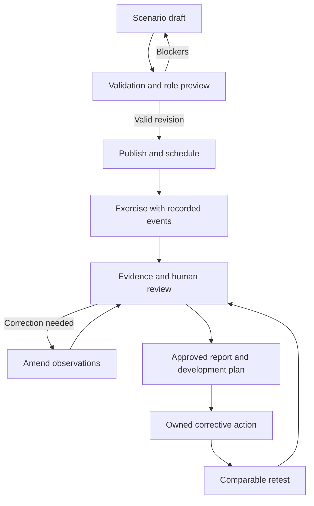

# Readiness Platform — UI/UX Agent Build Reference

Version 1.0 • October 9, 2026 • Functional beta interface specification

**Purpose:** A build contract for agents implementing the application UI: navigation, page outlines, reusable elements, visual rules, state transitions, permissions, data dependencies, and verification. This is a specification, not a claim that the UI or supporting APIs are implemented.

**Authoritative input:** `readiness-platform-beta-prd-and-architecture-2026-10-08.md`, PRD v0.1, current saved content reviewed October 9, 2026. References such as `PRD §8` and `REP-01` identify its sections and requirements. This document elaborates UI decisions without changing the PRD's scope. The PRD prevails on business rules, privacy, simulation authority, and P0/P1 priority. Proposed routes, component names, design tokens, and endpoint grouping below are implementation defaults, not previously approved branding or existing API contracts.

## 1. Build contract and scope

Build the complete beta lifecycle: organization setup → accepted context → scenario selection/import → customization → validation/publication → scheduling → live exercise → evidence review → approved reports → owned actions → personal development → retest.

Four disciplines share the application: incident response, disaster recovery, business continuity, and crisis management. Tabletop is a delivery mode. Practice versus assessment is a separate setting. Industry is a separate taxonomy dimension. Never use one dropdown that conflates these concepts.

### 1.1 Locked decisions

- Tenant-local access and evidence; explicit delegated client access; no client visibility merely from a partner relationship.
- Text-first simulation with role-specific views. Existing meeting tools can run alongside it; native Teams embedding and meeting bots are not beta requirements.
- Engine-confirmed actions, human-reviewed assessments, immutable published revisions, and explicit participant corrections.
- Version-specific expert attribution, including modification/expiry/revocation behavior.
- Private organization portal; personal coaching data excluded from commercial targeting.
- Logical JSON scenario portability; no raw database or user/secret dumps.
- No public employee rankings, automatic cross-tenant profiles, unsupported percentiles, or production incident-response controls.

### 1.2 Proposed visual direction

Calm, precise, information-dense, and readable. Management pages use a light neutral canvas. Exercise pages use a distinct operational layout with a dark header, stronger timing/connection cues, and light reading panels. Do not make a cybersecurity product depend on neon, glowing maps, simulated terminals, or an entirely dark UI. This reference does not assign a final product name or logo.

Public marketing pages, open creator payouts, native ticketing connectors, SCIM, custom domains, and technical-range controls are excluded. Curated offering detail, entitlement requests, publisher rights, internal operations, and secure invitations are included because the beta workflows depend on them.

### 1.3 How agents use this document

1. Read the common contracts before implementing a page.
2. Resolve page ID, requirement IDs, shell, capabilities, dependencies, and fixture states.
3. Reuse the registered components and semantic tokens; extend their central definitions when necessary.
4. Implement the page's read model, commands, validation, and transitions. Fixtures must use the same contract as live adapters.
5. Verify universal states plus page-specific cases, keyboard behavior, responsive layout, and unauthorized-data absence.
6. Report implemented IDs, test evidence, remaining backend blockers, and explicit deviations. Never present a fixture-only screen as a completed functional integration.

## 2. Information architecture and shells

### 2.1 Route conventions

`O = /o/:orgSlug`; `S = O/sessions/:sessionId`; `A = O/scenarios/:scenarioId/revisions/:revisionId`; `E = O/exercises/:exerciseId`.

These abbreviations expand literally in the catalog. Slugs are locators, not access grants. Stable IDs are opaque. Query parameters hold shareable filters, sort, page, active tab, selected permitted item, and comparison selection. Sensitive text, invite tokens, participant notes, and model prompts never go in URLs or analytics payloads.

Every tab with meaningful independent work gets a deep link and Back/Forward behavior. Drawers use a selected-resource parameter only when the ID is safe to reveal to that audience. The catalog lists route templates and substantive subviews, not every modal as a separate page.

### 2.2 Shell catalog

| Shell | Layout and navigation | Used for |
|---|---|---|
| SH-ACCESS | Compact centered identity card, tenant/invitation context only when permitted, help/footer | Authentication, invitations, account recovery |
| SH-PROGRAM | 240px left navigation, 64px top bar, main content, optional 360px detail inspector | Organization portal, catalog, exercises, analytics, people, settings |
| SH-AUTHOR | Program header plus revision/status strip; section rail; main editor; optional AI/diff inspector; save status | Scenario authoring; narrower program navigation to preserve space |
| SH-EXERCISE | 64px operational header, tenant/session/role, simulation and wall time, connection state; 48px task tabs; central workspace; role/evidence drawers | Participants and observers; no promotional cards or management sidebars |
| SH-CONTROL | Persistent “Facilitator control” identity, protected operational tabs, session controls, visible participant-preview action | Facilitator monitoring/adjudication; hidden data never sent to participant view |
| SH-REVIEW | Program frame plus review-progress rail, evidence/main split, explicit review/publish action strip | Findings and report approval |
| SH-PUBLISHER | Publisher identity and scoped navigation: profile/rights, reviews, publications | Experts and curated publishers; no organization telemetry |
| SH-OPS | Clearly separate platform-operations context, support-scope/expiry banner, audit trail | Operations, governance and approved support |

Program navigation: **Overview; Exercises; Scenarios; Reports; Actions; Analytics; People; My development; Recommendations; Organization**. “Reports” opens the dedicated report index. Show only permitted destinations; maintain a stable order. Notifications, exports/jobs, help, account, and organization switcher are utilities. Participant-only users receive a reduced navigation set, not disabled admin menus.

Publisher and operations workspaces require explicit context switching. Never mix their controls into the participant navigation. Organization switching closes tenant drawers, clears scoped caches and drafts according to the draft policy, unsubscribes from realtime feeds, and loads a fresh authorization snapshot before rendering the destination.

### 2.3 Layout primitives

| Layout | Geometry | Narrow-screen behavior |
|---|---|---|
| L-FORM | Max 760px, grouped fields, contextual help and explicit save | Single column; sticky action bar must not cover fields/errors |
| L-LIST | Header/action, filter row, results table/cards, pagination | Filter sheet; priority columns/cards; retain access to all fields |
| L-DETAIL | Header/status/actions, tab row, primary detail and optional sidebar | Sidebar stacks after primary content |
| L-SPLIT | List 300–360px + fluid detail, optional evidence drawer | List and detail become navigable views; preserve selection and scroll |
| L-DASH | Max 1440px, 12-column desktop grid, clear section hierarchy | 2-column tablet and 1-column mobile; no miniature desktop dashboard |
| L-EDITOR | Section navigation 220px + editor ≥480px + inspector 360px when space allows | Inspector becomes sheet; structural graph gets equivalent list editor |
| L-LIVE | Feed/workspace with contextual detail and pinned essential state | One work pane at a time; header, role and connection state remain available |

Breakpoints are viewport classes: compact <768px; medium 768–1199px; wide ≥1200px. Program navigation collapses below 1024px. Do not infer device capability solely from width. All essential participant, review, and administrative tasks remain possible on compact layouts; facilitate desktop use through better density, not blocking banners.

## 3. Visual styles and design tokens

These are proposed initial tokens. Validate contrast in rendered components before release. Tenant branding may change a logo and constrained accent; it may not override semantic statuses, contrast, typography scale, or exercise warnings.

| Token family | Initial values | Usage |
|---|---|---|
| Canvas/surface | `canvas #F5F7FA`; `surface #FFFFFF`; `surface-subtle #EEF2F6`; `surface-selected #E8F0FF` | Large areas; selected treatment always includes an additional non-color cue |
| Text | `text #172033`; `text-muted #526176`; `text-on-dark #F8FAFC` | Muted is still readable; never lighten essential text into decoration |
| Borders | `border #D5DDE7`; `border-control #7B8798` | Decorative separators versus boundaries needed to identify inputs |
| Primary | `primary #2457C5`; `primary-hover #19449F`; `primary-soft #E8F0FF` | Primary actions and selected navigation, not all links and all cards simultaneously |
| Semantic | `success #146C43/#ECFDF3`; `warning #8A4B08/#FFF7E6`; `danger #B42318/#FFF1F0`; `info #175CD3/#EFF8FF` | Foreground/background pairs; combine icon, text and status |
| Exercise chrome | `exercise-header #162236`; `exercise-panel #FFFFFF`; `exercise-canvas #E9EEF4` | Distinct workspace without reducing evidence readability |
| Typography | System sans-serif; system monospace only for IDs, logs, timestamps | No font download dependency; tabular numerals for metrics/clocks |
| Type scale | 12/16 metadata; 14/20 compact UI; 16/24 reading; 20/28 section; 24/32 page; 32/40 hero metric | Do not use 12px for primary content; weights 400/500/600 |
| Spacing | 4, 8, 12, 16, 24, 32, 48px | 4px base; default page padding 24px wide, 16px compact |
| Radius | 6px controls; 10px cards/dialogs; pill only for compact tags | Avoid excessive nested cards and pill-shaped everything |
| Elevation | None by default; low border/shadow for popovers, medium for modal surfaces | Hierarchy primarily from layout, spacing and type |
| Controls | 40px default height; 44px touch hit region; 32px dense only with adequate target spacing | Labels above fields; visible required/optional conventions |
| Focus | 2px high-contrast focus outline with 2px offset; inverse token on dark chrome | Never remove focus rings or rely on shadow alone |
| Motion | 120ms state response; 180ms drawer/menu; no decorative loops | Reduced-motion setting removes movement; progress remains understandable |
| Layer order | Base 0; sticky 10; dropdown 30; drawer 40; modal 50; toast 60 | Central tokens; no arbitrary per-page z-index escalation |

Style variants to implement centrally: button primary/secondary/tertiary/destructive; input default/error/read-only/disabled; card standard/selected/actionable; badge neutral/lifecycle/severity/attribution; table standard/compact; simulated-message types email/chat/media/system; evidence types document/log/image/link; metric supported/suppressed/not-observed/stale.

Charts use a fixed accessible categorical palette with redundant labels/patterns. Red/green pairs cannot be the only distinction. Use horizontal bars for objective coverage and action aging, line charts only for comparable time-series points, matrices for role/objective coverage, and event timelines for chronology. No radar-chart “personality” profiles, unexplained readiness gauges, or interpolated trends across incomparable exercises. Every chart has a table alternative, units, denominator, scope, date range, and freshness.

Print/report style: white background, readable body text, section hierarchy, repeated table headers, deliberate page breaks, version/audience/simulation scope in header or footer, accessible hyperlinks, no navigation chrome. Never hide prohibited sections with print CSS; they must be absent from the export data.

## 4. Component and UI-element catalog

Component IDs are stable design contracts, not a mandate for one file per row. Use TypeScript props and explicit state variants. Presentational components do not fetch global tenant data or infer permissions.

| ID / component | Elements and variants | Contract / important behavior |
|---|---|---|
| C01 AppFrame | Shell, navigation, breadcrumbs, page title/actions, skip link | Receives current scope and authorized navigation; clears on context change |
| C02 ScopeSwitcher | Organization avatar/name, search, delegated badge, publisher/account entries | Explicit context; confirm unsaved changes; never prefetch unauthorized client content |
| C03 AccessBoundary | Loading, sign-in-required, unavailable, forbidden-with-safe-context, expired grant | Server authorization remains authoritative; no sensitive flash before checks |
| C04 PageState | Skeleton, empty, no-results, partial, retry, stale, unavailable | Each state names next permissible action; error has safe correlation reference |
| C05 DataTable | Sort, selection, pagination, row actions, column visibility, compact variant | Stable row IDs; labeled checkboxes; server filters; no hidden authorized-only columns fetched by default |
| C06 FilterBar | Search, facets, date range, chips, clear, saved view | URL-safe state; distinguish zero results from no records; cancel obsolete queries |
| C07 FormField | Text, textarea, number, select, combobox, multiselect, date/time, checkbox, radio, switch | Label/help/error wiring; dirty/touched; units; validated timezone and numeric limits |
| C08 ActionButton | Primary, secondary, tertiary, destructive, icon, pending | Prevent duplicate submission; pending does not mean success |
| C09 StatusBadge | Lifecycle, connection, review, provenance, severity, approval | Server status → label/icon/tone mapping; distinct vocabularies stay distinct |
| C10 DialogSheet | Confirm, form, resource detail, command preview, conflict | Focus trap/return; named heading; Escape where safe; one primary modal at a time |
| C11 Feedback | Inline alert, banner, toast, field summary | Durable errors remain inline; toast is not the only record of an action |
| C12 JobProgress | Queue stage, progress if known, retry, cancel when supported, result link | Indeterminate until backend provides progress; no fabricated percent complete |
| C13 UploadSource | File picker/drop zone, file list, scan/extract state, source preview | File count/size/type checks; text alternative; never render unsafe uploaded HTML |
| C14 SourceFact | Fact value/type, source excerpt, date, sensitivity, freshness, accept/edit/exclude | Accepted provenance persists; revisions show downstream impact |
| C15 ScenarioCard | Title, discipline, role/objective summary, duration, difficulty, edition/entitlement | Distinct available/locked/retired states; never imply expert approval from an avatar alone |
| C16 TaxonomyPicker | Discipline, industry, mode, purpose, skills, difficulty | Separate dimensions; schema-backed allowed values |
| C17 AttributionCard | Authored/reviewed/endorsed identity, scope, revision, dates, rights/status | Derived, expired, revoked and unverified states have explicit text |
| C18 RevisionDiff | Revision picker, semantic diff, changed references, approval impact, conflict resolution | Immutable published content; applying a diff creates/updates only an authorized draft |
| C19 ScenarioEditor | Entity/action/condition forms, role editor, transition list, optional graph | Registered action schemas; keyboard list parity; never execute uploaded code |
| C20 RubricEditor | Objective, opportunity, roles, anchors 0–3, evidence, exclusion, weight/threshold | “Not observed” and “not applicable” are nonnumeric; validates eligibility/coverage rules |
| C21 AIProposalPanel | Prompt, source scope, queued/generating/proposed/error, affected sections, accept/reject | Suggestions do not silently save/publish; draft version checked on apply |
| C22 ValidationPanel | Blockers/warnings, severity, affected object, fix link, dry-run trace | Link to exact field; status invalidates when draft digest changes |
| C23 RoleRoster | Human/AI/observer identity, role, invite/readiness/presence, assignment | Missing executive is not secretly represented by a human score; presence ≠ participation quality |
| C24 SessionHeader | Simulation label, title, role, purpose, clocks, lifecycle, connection | Simulation clock is authoritative; wall time is distinctly labeled |
| C25 SituationFeed | Event type, source, delivery time, audience, unread marker, pinned item | New events do not steal focus/scroll; user chooses jump-to-latest |
| C26 CommunicationInbox | Channel/thread list, sender/actor tag, audience, composer, attachments | Simulated external parties clearly labeled; recipient permission checked on send |
| C27 EvidenceViewer | Search/list, artifact metadata, safe preview, excerpt/reference, version | Available evidence only; download permission independent of preview permission |
| C28 ActionConsole | Intent input, typed preview, required parameters, submit, result, clarification | Distinguish propose/submit/accepted/executed/rejected/unknown; no optimistic world-state changes |
| C29 DecisionRecord | Question, options, owner, rationale, participants, references, commitment/outcome | Agreement is not execution; edits are revisions; dissent/uncertainty can be recorded |
| C30 TeamWorkspace | Situation note, ownership/handoffs, commitments, references, update history | Explicit save with version check; no silent concurrent overwrites |
| C31 FacilitatorControls | Start/pause/resume/end, stepped advance, inject queue, override | Pause immediate; end/override require impact confirmation and rationale |
| C32 ActorInspector | Known facts, permitted resources, proposed/accepted actions, concise rationale | Facilitator-only; no model private chain-of-thought display |
| C33 TimelineReplay | Timeline, event filters, seek, playback, perspective, event detail | Read-only recorded state; never reruns the model or commits actions |
| C34 FindingReview | Finding, subject, opportunity, rubric, evidence, inference level, review actions | Missing evidence blocks approval; correction disputes remain visible |
| C35 AudienceSelector | Named scope/groups/roles, sections, recipients, access preview | Positive permissions; not a CSS mask over unrestricted content |
| C36 ReportDocument | TOC, sections, evidence links, limitations, approval/version, exports | Draft watermark; approved snapshot; missing/restricted evidence handled explicitly |
| C37 MetricCard | Value, unit, period, denominator, coverage, freshness, drill-down | Suppressed and not-observed states are not rendered as zero |
| C38 AnalyticsView | Charts/table alternative, filters, saved views, CSV export | Consistent read-model definitions; no locally invented scoring |
| C39 ActionItem | Owner/due/status/source/acceptance evidence/retest | Implemented versus verified separate; overdue is derived status |
| C40 DevelopmentCard | Skill, role/context, observations, strengths, goals, coach feedback | Permission-scoped evidence; no universal competence score |
| C41 RecommendationCard | Offering, fit rationale, prerequisites, rights, dismiss, paid label | No individual weaknesses in sales payload; recommendation ≠ endorsement |
| C42 GrantEditor | Principal, capabilities, resource scope, expiry, review/revoke | No broad defaults; show exact effect; revocation updates active interfaces |
| C43 AuditTable | Actor, action, resource, timestamp, outcome, safe details | Secrets/content excluded from generic log views |
| C44 ExportBuilder | Format, scope, redaction preview, rights, destination download, job | No unauthorized data leaves server; failed/expired job can be regenerated if still allowed |
| C45 EmptyOnboarding | Checklist, context-sensitive next action, progress | No fictional metrics/content to fill an empty organization |
| C46 RichText | Restricted formatting, links, lists, evidence references | Sanitized; plain-text fallback; no arbitrary embeds/scripts |
| C47 HelpDisclosure | Context help, glossary, limitation, privacy explanation | Does not expose hidden scenario clues; practice hints separately gated/logged |
| C48 DateTime | Zoned date picker, absolute/relative display, elapsed timer | Store instants; display chosen timezone; expose absolute time on relative labels |

All pages additionally use semantic headings, labeled landmarks, links, separators, avatars with fallback initials, icons with accessible names when actionable, and tooltips only as supplementary help. Provide field-level error text and an error summary for long forms. Never use placeholder text as the sole label.

## 5. Universal states and interaction rules

Every screen inherits U01–U12 where applicable. Screen entries list additional states; they do not waive these defaults.

| State | Required presentation and behavior |
|---|---|
| U01 Initial loading | Structure-matching skeleton; accessible loading label; no old-tenant content |
| U02 Ready | Authorized data, current scope, primary action, freshness where relevant |
| U03 Empty | Explain absence; offer authorized creation/join/setup path; no invented records |
| U04 Filtered empty | Keep filters; show Clear filters; distinguish from first-use state |
| U05 Partial/stale | Show successful regions; mark failed/stale regions with timestamp and local retry |
| U06 Error | Preserve safe input; actionable message; retry by operation; safe support reference |
| U07 Unauthenticated/expired | Reauthenticate and return to a safe route; clear private rendered content when session expires |
| U08 Forbidden/not found/revoked | No private title/preview leaks; generic unavailable for undiscoverable resources; request access only through an authorized owner path |
| U09 Mutation pending | Disable duplicate action; display pending; preserve idempotency key; do not announce completion early |
| U10 Success | Show committed result and next action; maintain durable audit/status record, not only toast |
| U11 Conflict/unsaved | Show local versus current revision and recoverable choices; never overwrite silently; warn before leaving dirty work |
| U12 Disconnected/read-only | Persistent connectivity status; retain last snapshot labeled stale; disable commands that require live authority |

Accessibility applies to all states: logical keyboard order; visible focus; labels and errors; 200% text zoom; reflow at 320 CSS px for ordinary content; table/graph overflow contained in labeled regions; reduced motion; polite status announcements; no announcement flood from every live message. Live new-event counts are batched, and alerts use assertive announcements only for genuinely urgent state changes.

**Draft policy:** authoring forms autosave versioned drafts after validation/debounce, with Saved/Saving/Unsaved/Conflict states. Consequential commands, grants, approval, publication, settings, and team decisions require explicit submission. Text composers remain in session memory by default; do not persist confidential text to localStorage. A network loss preserves an unsent local draft while the tab remains open, but the UI must not promise recovery after tab closure. Clearing tenant scope clears its private memory.

**Realtime policy:** events arrive ordered by server sequence; show gap/reconnecting state and fetch missing authorized events. A timeout after submission produces “Outcome not yet confirmed,” with status lookup using the original command ID. Never offer a new idempotency key as a blind retry of a consequential action. Do not queue offline simulated actions for automatic later execution.

**Permissions:** server capabilities determine visible actions and returned data. Hide undiscoverable resources; use disabled actions with explanations only for discoverable but temporarily unavailable operations. Capability removal clears cached sensitive views, closes their drawers, and prevents export; displaying a disabled button alone is insufficient.

**Entity state is separate from request state.** A published report can be loading; a running session can be disconnected; an approval can be revoked while its historical session remains archived. Model these independently.

## 6. Dependencies and capability vocabulary

| Service key | Required read models | Commands/events consumed by UI |
|---|---|---|
| D-ID | Session identity, membership, capabilities, guest verification, account security | Sign in/out, verify invite, switch authorized scope, reauthenticate |
| D-ORG | Organization profile/settings, branding, delegation and membership | Create/update organization, invite/revoke member/grant |
| D-CTX | Documents, facts, provenance, freshness and impact | Upload, scan/extract jobs, accept/edit/exclude fact |
| D-CAT | Safe catalog preview, licensed content, taxonomy, entitlements | Fork, request access, catalog publication/retirement |
| D-AUTH | Draft/revision, structured schema, diffs, validation runs | Save/fork, generate proposal, apply/reject, dry-run, publish |
| D-EXP | Expert identity, rights, review requests, approvals/revocations | Submit verification, request changes, approve scoped revision, countersign/revoke |
| D-PKG | Package manifests, rights/compatibility checks, import/export jobs | Validate/dry-run/commit import, prepare permitted export |
| D-EX | Exercises, schedules, invitations, role assignments | Schedule/reschedule/cancel, assign roles, open lobby |
| D-SIM | Audience-filtered snapshot/events, command status, clocks, actor observations | Start/pause/resume/end, typed action, message, inject, adjudicate; ordered event stream |
| D-EVD | Authorized evidence, opportunities, attribution, observations/findings | Draft generation, review decision, dispute, correction/amendment |
| D-REP | Report revisions, audiences, approval status, export jobs | Generate/edit/review/approve/publish/withdraw/amend |
| D-ANA | Approved metrics, coverage, comparison eligibility, saved views | Save view, drill-down, CSV job; projection freshness |
| D-ACT | Corrective actions, goals, ownership, verification/retest links | Assign/update, submit implementation evidence, verify through retest |
| D-PEO | Directory, permitted profile, coaching grants, personal development | Update allowed profile fields/goals, challenge attribution, passport export |
| D-REC | Authorized recommendations/offers, rationale and preference | Dismiss/feedback, configure promotion categories, submit approved contact request |
| D-OPS | Jobs, usage, audit, retention/deletion status, support grants, integration deliveries | Retry allowed jobs, delete/export request, support scope activation, webhook management |

Every data dependency includes D-ID and scope enforcement unless the screen is explicitly pre-authentication. Lists return permitted totals, not global totals that reveal hidden records. Background jobs return safe stage/failure/result metadata, not internal prompts or stack traces. These are logical API contracts; endpoint URLs and backend implementation remain separate engineering work.

Capabilities are resource-scoped verbs such as `scenario.edit`, `session.facilitate`, `report.publish`, `profile.coach`, `organization.admin`, and `publisher.review`. Persona labels below summarize eligibility; they never imply unrestricted access. Owner ≠ coach; author ≠ expert reviewer; observer ≠ participant; operator ≠ customer user.

## 7. User-flow map

| Flow | Ordered screens | Branches and successful outcome |
|---|---|---|
| F01 Organization start | ACC-01 → ACC-03 → ACC-04 → CTX-01 → CTX-02 → CTX-03 → HOME-01 | Manual context can skip upload; accepted facts ready for reuse |
| F02 Catalog to published scenario | CAT-01 → CAT-02 → AUT-02 → AUT-03 → AUT-04 → AUT-05 → AUT-06 → AUT-07 → AUT-08 | Validation blockers return to affected section; expert approval impact visible before fork publish |
| F03 Portable content | PKG-01 → AUT-01 → AUT-07 → AUT-08; AUT-01/CAT-02 → PKG-02 → HOME-03 | Import creates draft; export honors rights and redaction |
| F04 Schedule and join | EX-01 → EX-02 → EX-03; ACC-02 → EX-04 → SIM-01 | Missing identity/role/consent blocks join; guest remains exercise-scoped |
| F05 Participate | SIM-01 ↔ SIM-02 ↔ SIM-03 ↔ SIM-04 ↔ SIM-05 ↔ SIM-06 → REV-01 | Messages/decisions do not imply executed actions; observation/role brief available as drawer |
| F06 Facilitate | EX-03 → FAC-01 ↔ FAC-02 ↔ FAC-03 ↔ FAC-04 → REV-01 → FAC-05 | Pause/fallback/reconnect/override paths preserve audit and assessment impact |
| F07 Review and publish | REV-01 → REV-02 → REV-03 → REV-04 → REV-05 → REP-01/HOME-01 | Corrections reopen review; approval/publishing separate permissions |
| F08 Improve and retest | REV-03 → ACT-02 → ACT-01 → EX-02 → ANA-03 | Implementation evidence separate from retest verification |
| F09 Personal development | PEO-01 → PEO-02 → PEO-03; PEO-02 → REV-03 | Self or coaching grant; correction route displays only subject-authorized evidence |
| F10 Expert edition | PUB-01 → PUB-02 → PUB-03 → PUB-04 → CAT-02 | Scope changes require fresh approval; expired/revoked status flows into catalog |
| F11 Relevant offerings | HOME-01/REC-01 → CAT-02 or REC-02 → EX-02/access request | Paid offers labeled; contact request requires authorized review and submit |
| F12 Organization administration | SET-01 → SET-02/SET-03/SET-04/SET-05/SET-06/SET-07 | Revocation, deletion and integration changes have clear impact confirmation |
| F13 Operational support | OPS-01 → OPS-03 → scoped customer screen → OPS-03 | Grant has expiry; all access audited; no silent impersonation |

## 8. Screen catalog and page outlines

All catalog entries are P0 UI surfaces unless a behavior explicitly states otherwise. Each entry's **States** extends the universal state contract. **Depends** lists service and upstream UI dependencies. **Verify** is the page-specific acceptance case. Routes for tabs are real deep links. Shared components handle common elements; this is not a mandate for dozens of unrelated layouts.

Screen inventory: **70 route/subview specifications**. Route abbreviations are defined in §2.1.

| Screen ID | Page/subview | Route | Shell/layout |
|---|---|---|---|
| ACC-01 | Sign in and identity recovery | `/sign-in` (provider callback/recovery returns here) | SH-ACCESS / L-FORM |
| ACC-02 | Invitation acceptance and guest verification | `/invite/:inviteToken` | SH-ACCESS / L-FORM |
| ACC-03 | Organization and workspace chooser | `/workspaces` | SH-ACCESS / L-LIST |
| ACC-04 | Organization onboarding | `/organizations/new` | SH-ACCESS / L-FORM stepper |
| ACC-05 | Personal account and security | `/account` | SH-PROGRAM without tenant content / L-FORM |
| HOME-01 | Private organization overview | `O` | SH-PROGRAM / L-DASH |
| HOME-02 | Notifications and activity inbox | `O/notifications` | SH-PROGRAM / L-LIST |
| HOME-03 | Jobs, downloads, and exports | `O/jobs` | SH-PROGRAM / L-LIST with detail drawer |
| CTX-01 | Organization context profile | `O/context` | SH-PROGRAM / L-DETAIL |
| CTX-02 | Source documents | `O/context/documents` | SH-PROGRAM / L-LIST |
| CTX-03 | Extracted fact review | `O/context/documents/:documentId/review` | SH-REVIEW / L-SPLIT |
| CAT-01 | Scenario Library and Expert Editions | `O/scenarios/catalog` | SH-PROGRAM / L-LIST card/table toggle |
| CAT-02 | Scenario detail and permitted preview | `O/scenarios/catalog/:catalogId` | SH-PROGRAM / L-DETAIL |
| CAT-03 | Expert profile and attribution details | `O/experts/:expertId` | SH-PROGRAM / L-DETAIL |
| AUT-01 | Organization scenario workspace | `O/scenarios` | SH-PROGRAM / L-LIST |
| AUT-02 | Scenario brief and organization bindings | `A/brief` | SH-AUTHOR / L-EDITOR |
| AUT-03 | Roles, actors, world state, and rules | `A/world` | SH-AUTHOR / L-EDITOR |
| AUT-04 | Injects, channels, and artifacts | `A/content` | SH-AUTHOR / L-SPLIT |
| AUT-05 | Objectives, opportunities, and rubrics | `A/assessment` | SH-AUTHOR / L-EDITOR |
| AUT-06 | Revision history, semantic diff, and AI changes | `A/changes` | SH-AUTHOR / L-SPLIT |
| AUT-07 | Validation and dry run | `A/validate` | SH-AUTHOR / L-DETAIL |
| AUT-08 | Publish scenario revision | `A/publish` | SH-AUTHOR / L-FORM |
| PKG-01 | Import scenario package | `O/scenario-imports/new` and `O/scenario-imports/:importId` | SH-PROGRAM / L-FORM with result inspector |
| PKG-02 | Export scenario package | `A/export` | SH-PROGRAM / L-FORM |
| EX-01 | Exercise program and calendar | `O/exercises` | SH-PROGRAM / L-LIST with calendar view |
| EX-02 | Exercise scheduling and configuration | `O/exercises/new` and `E/edit` | SH-PROGRAM / L-FORM stepper |
| EX-03 | Exercise overview and readiness | `E` | SH-PROGRAM / L-DETAIL |
| EX-04 | Lobby, role brief, and participation disclosure | `S/lobby` | SH-EXERCISE / L-DETAIL |
| SIM-01 | Live situation | `S/live/situation` | SH-EXERCISE / L-LIVE |
| SIM-02 | Simulated communications | `S/live/communications` with safe thread selection | SH-EXERCISE / L-SPLIT |
| SIM-03 | Evidence library and inspector | `S/live/evidence` with selected artifact | SH-EXERCISE / L-SPLIT |
| SIM-04 | Investigation and action console | `S/live/investigate` | SH-EXERCISE / L-LIVE |
| SIM-05 | Decisions and commitments | `S/live/decisions` | SH-EXERCISE / L-LIST with decision detail |
| SIM-06 | Shared team workspace | `S/live/team` | SH-EXERCISE / L-LIVE |
| FAC-01 | Facilitator control room | `S/control` | SH-CONTROL / L-DASH |
| FAC-02 | World state and actor inspector | `S/control/world` | SH-CONTROL / L-SPLIT |
| FAC-03 | Inject queue and pacing | `S/control/injects` | SH-CONTROL / L-LIST with editor |
| FAC-04 | Adjudication and controlled overrides | `S/control/adjudication` | SH-CONTROL / L-SPLIT |
| FAC-05 | Recorded session replay | `S/replay` | SH-REVIEW / L-LIVE |
| REV-01 | Exercise completion and debrief | `S/debrief` | SH-PROGRAM / L-DETAIL |
| REV-02 | Findings and observation review queue | `S/review/findings` | SH-REVIEW / L-LIST |
| REV-03 | Finding, evidence, and correction detail | `O/findings/:findingId` | SH-REVIEW / L-SPLIT; restricted participant variant |
| REV-04 | Report composition, review, and publication | `O/reports/:reportId/edit` | SH-REVIEW / L-EDITOR |
| REV-05 | Published report reader | `O/reports/:reportId` with revision selection | SH-PROGRAM / L-DETAIL reading layout |
| REP-01 | Report library | `O/reports` | SH-PROGRAM / L-LIST |
| ANA-01 | Program analytics | `O/analytics` | SH-PROGRAM / L-DASH |
| ANA-02 | Exercise analytics and coverage | `S/analytics` | SH-PROGRAM / L-DASH |
| ANA-03 | Retest comparison | `O/analytics/compare` with authorized baseline/retest IDs | SH-PROGRAM / L-DETAIL |
| ACT-01 | Corrective-action program | `O/actions` | SH-PROGRAM / L-LIST |
| ACT-02 | Corrective-action detail and verification | `O/actions/:actionId` | SH-PROGRAM / L-DETAIL |
| PEO-01 | People and role directory | `O/people` | SH-PROGRAM / L-LIST |
| PEO-02 | Participant profile and observations | `O/people/:participantId`; `O/me` resolves to self without changing scope | SH-PROGRAM / L-DETAIL |
| PEO-03 | Personal development plan | `O/people/:participantId/development` | SH-PROGRAM / L-DETAIL |
| REC-01 | Recommended practice and offerings | `O/recommendations` | SH-PROGRAM / L-LIST cards |
| REC-02 | Service offering and contact request | `O/offerings/:offeringId` | SH-PROGRAM / L-DETAIL |
| SET-01 | Organization identity, branding, and preferences | `O/settings/general` | SH-PROGRAM / L-FORM |
| SET-02 | Members, invitations, and coaching assignments | `O/settings/members` | SH-PROGRAM / L-LIST with grant drawer |
| SET-03 | Partner delegation and support grants | `O/settings/delegation` | SH-PROGRAM / L-LIST with grant editor |
| SET-04 | Privacy, retention, data export, and deletion | `O/settings/privacy` | SH-PROGRAM / L-FORM with jobs/history |
| SET-05 | Plan, entitlements, and usage | `O/settings/plan` | SH-PROGRAM / L-DETAIL |
| SET-06 | Integrations and webhook deliveries | `O/settings/integrations` | SH-PROGRAM / L-LIST/detail |
| SET-07 | Organization audit history | `O/settings/audit` | SH-PROGRAM / L-LIST |
| PUB-01 | Expert identity and rights setup | `/publisher/profile` | SH-PUBLISHER / L-FORM |
| PUB-02 | Expert review inbox | `/publisher/reviews` | SH-PUBLISHER / L-LIST |
| PUB-03 | Expert content and rubric review | `/publisher/reviews/:reviewId` | SH-PUBLISHER / L-EDITOR |
| PUB-04 | Publications, approvals, and revocations | `/publisher/publications` | SH-PUBLISHER / L-LIST/detail |
| OPS-01 | Platform health, usage, and jobs | `/ops` | SH-OPS / L-DASH |
| OPS-02 | Catalog governance and entitlement administration | `/ops/catalog` | SH-OPS / L-LIST/detail |
| OPS-03 | Scoped support access | `/ops/support` | SH-OPS / L-LIST/detail |
| OPS-04 | Retention and deletion operations | `/ops/data-jobs` | SH-OPS / L-LIST/detail |

### ACC-01 — Sign in and identity recovery

**Route:** `/sign-in` (provider callback/recovery returns here). **Shell/layout:** SH-ACCESS / L-FORM. **Access:** unauthenticated. **Trace:** TEN-01, OPS-01; F01/F04.

**Outline:** Product identity → permitted sign-in methods → verification/MFA step when required → help/recovery → safe return destination. Identity provider owns credential recovery; do not build a second password database.

**Actions:** Sign in, verify, recover, retry. **States:** provider redirect, challenge pending/invalid/expired, locked/rate-limited, canceled, organization unavailable, success. **Depends:** D-ID; provider configuration. **Components:** C03, C07, C08, C11.

**Verify:** Expired identity never renders the prior tenant's page while redirecting; successful sign-in returns only to an allowlisted, authorized destination.

### ACC-02 — Invitation acceptance and guest verification

**Route:** `/invite/:inviteToken`. **Shell/layout:** SH-ACCESS / L-FORM. **Access:** invite recipient after required verification. **Trace:** TEN-01, INT-01; F04.

**Outline:** Safe invitation context → identity verification → disclosed exercise/role and privacy terms → accept/decline → assigned lobby. Token is redacted from telemetry and removed from the URL after exchange.

**Actions:** Verify recipient, accept, decline, request new invitation. **States:** verifying, valid, mismatched account, expired, revoked, already accepted, exercise canceled/ended. **Depends:** D-ID, D-EX; SET-02/EX-02 invitation. **Components:** C03, C07, C11, C23.

**Verify:** Reusing an accepted invitation cannot create duplicate membership; a revoked invite reveals no hidden scenario material.

### ACC-03 — Organization and workspace chooser

**Route:** `/workspaces`. **Shell/layout:** SH-ACCESS / L-LIST. **Access:** authenticated user. **Trace:** TEN-01; F01/F13.

**Outline:** Current account → accessible organizations with direct/delegated labels → publisher/operations entries if granted → create organization if permitted. No cross-client metrics on this screen.

**Actions:** Switch, create, sign out. **States:** no memberships, single membership, many/search, delegated grant expired/revoked, organization suspended. **Depends:** D-ID, D-ORG; ACC-01. **Components:** C02, C04, C06, C09.

**Verify:** Switching flushes scoped caches/subscriptions before rendering new data; absent grants do not produce disabled cards that reveal client identities.

### ACC-04 — Organization onboarding

**Route:** `/organizations/new`. **Shell/layout:** SH-ACCESS / L-FORM stepper. **Access:** organization-create capability. **Trace:** TEN-01, CTX-01, OPS-01; F01.

**Outline:** Organization name/slug/timezone → program owner → participant privacy and retention defaults → administrator invites → review/create → context setup. Show what can be changed later.

**Actions:** Continue/back, create, resume saved setup. **States:** invalid/taken slug, owner incomplete, draft, submission pending, created but invitation delivery failed, resumed. **Depends:** D-ORG, D-ID; ACC-03. **Components:** C07, C12, C35, C45, C48.

**Verify:** A partial invitation failure does not duplicate the organization on retry; privacy decisions are persisted before exercises can collect evidence.

### ACC-05 — Personal account and security

**Route:** `/account`. **Shell/layout:** SH-PROGRAM without tenant content / L-FORM. **Access:** self. **Trace:** TEN-01, OPS-01.

**Outline:** Display details → timezone/accessibility preferences → identity/MFA management link → active account sessions → notification preferences → sign out. Tenant-local exercise profiles are linked separately.

**Actions:** Save own details/preferences, manage security, revoke account session. **States:** provider-managed field read-only, MFA required, preference save failure, current session revoked. **Depends:** D-ID, D-OPS. **Components:** C07, C10, C11, C48.

**Verify:** Editing account identity does not merge guest exercise records or reveal profiles from another organization.

### HOME-01 — Private organization overview

**Route:** `O`. **Shell/layout:** SH-PROGRAM / L-DASH. **Access:** organization member or scoped delegate. **Trace:** POR-01, REP-01, ACT-01, DEV-01; F01/F07/F11.

**Outline:** Organization/program heading → upcoming or active assigned exercise → latest approved recap → authorized due actions → reviewed coverage summary → own development shortcut → recommended practice → separately labeled optional paid offerings. Administrators see setup checklist when needed.

**Actions:** Join/prepare exercise, read recap, resolve action, view recommendation. **States:** first use, no published recap, partial cards, suppressed metrics, promotions disabled, participant-only variant. **Depends:** D-ORG, D-EX, D-REP, D-ACT, D-ANA, D-REC. **Components:** C15, C37, C39–C41, C45.

**Verify:** Each card is independently authorized; no empty private-profile placeholders or fake readiness score appear for an untested organization.

### HOME-02 — Notifications and activity inbox

**Route:** `O/notifications`. **Shell/layout:** SH-PROGRAM / L-LIST. **Access:** current recipient. **Trace:** INT-01, ACT-01, REP-01.

**Outline:** Unread/all filters → invitation, review, action, publication and job notifications → timestamp/actor/safe summary → resource link. Distinguish platform notifications from simulated exercise messages.

**Actions:** Open, mark read, manage preferences. **States:** empty, unread, read, stale destination, grant revoked, delivery status unavailable. **Depends:** D-OPS and source resources; every destination reauthorizes. **Components:** C05, C06, C09, C48.

**Verify:** Notification preview does not retain sensitive text after access is revoked; marking read does not mutate the underlying action/task.

### HOME-03 — Jobs, downloads, and exports

**Route:** `O/jobs`. **Shell/layout:** SH-PROGRAM / L-LIST with detail drawer. **Access:** job owner or granted manager. **Trace:** PKG-01, REP-01, OPS-01.

**Outline:** Job type/status filter → queued/running/completed/failed jobs → scope/format/requested time → result link or failure/retry. Display download expiry and report/package revision.

**Actions:** Download, retry, cancel if backend supports it, open source. **States:** queued, running, partial failure, complete, expired artifact, canceled, source access revoked. **Depends:** D-OPS, D-PKG, D-REP. **Components:** C05, C12, C44.

**Verify:** Download checks current authorization; a prior successful export never overrides revocation, expiry, or report withdrawal.

### CTX-01 — Organization context profile

**Route:** `O/context`. **Shell/layout:** SH-PROGRAM / L-DETAIL. **Access:** context-view/edit grants. **Trace:** CTX-01; F01.

**Outline:** Completeness/freshness → tabs for services/assets, vendors, teams/escalation, business constraints/recovery targets, terminology → fact/source inspector → affected draft scenarios.

**Actions:** Add/edit/archive fact, set sensitivity/validity, open source, review downstream impact. **States:** empty, stale, disputed, conflicting facts, read-only, unsaved edit. **Depends:** D-CTX, D-ORG, D-AUTH; ACC-04. **Components:** C07, C14, C18, C48.

**Verify:** Recovery targets carry units and service scope; changing accepted context never mutates a pinned published or running scenario.

### CTX-02 — Source documents

**Route:** `O/context/documents`. **Shell/layout:** SH-PROGRAM / L-LIST. **Access:** context-source grants. **Trace:** CTX-01, OPS-01; F01.

**Outline:** Upload action/accepted formats and limits → source list with version/sensitivity/status → safe preview → extraction summary and review facts action.

**Actions:** Upload, classify, replace as revision, retry extraction, request delete. **States:** uploading, scanning, quarantined, rejected, extracting, extracted, partially extracted, stale/superseded, deleted. **Depends:** D-CTX, D-OPS. **Components:** C13, C12, C27, C10.

**Verify:** Extracted content never counts as accepted context until reviewed; unsafe files cannot render inline or inject instructions into the UI.

### CTX-03 — Extracted fact review

**Route:** `O/context/documents/:documentId/review`. **Shell/layout:** SH-REVIEW / L-SPLIT. **Access:** context-review grant. **Trace:** CTX-01; F01.

**Outline:** Source excerpt pane → proposed facts grouped by type → accepted/current-value comparison → sensitivity/expiry → review progress and summary.

**Actions:** Accept, edit and accept, exclude, resolve conflict; bulk accept only explicitly selected eligible facts. **States:** unreviewed, accepted, excluded, conflict, missing source, extraction incomplete, concurrent review. **Depends:** D-CTX; CTX-02. **Components:** C14, C18, C27, C07.

**Verify:** Every accepted value retains source and reviewer; changing source revision warns before applying stale proposals.

### CAT-01 — Scenario Library and Expert Editions

**Route:** `O/scenarios/catalog`. **Shell/layout:** SH-PROGRAM / L-LIST card/table toggle. **Access:** catalog-discover grant. **Trace:** CAT-01, EXP-01, ENT-01; F02/F11.

**Outline:** Search → Library/Expert Editions/Organization content filters → separate taxonomy facets → result count/cards → pagination → create/import when allowed. Expert Editions uses the same catalog, not a duplicate product hierarchy.

**Actions:** Inspect, save filter, customize licensed scenario, request entitlement. **States:** no results, no expert agreements/content, locked edition, retired listing, available organization fork. **Depends:** D-CAT, D-EXP; D-ANA for saved filters if shared service. **Components:** C06, C15–C17.

**Verify:** Unlicensed previews omit hidden injects/rubrics; zero expert content does not display fabricated people or endorsements.

### CAT-02 — Scenario detail and permitted preview

**Route:** `O/scenarios/catalog/:catalogId`. **Shell/layout:** SH-PROGRAM / L-DETAIL. **Access:** discover; full preview only with content permission. **Trace:** CAT-01, EXP-01, ENT-01; F02/F11.

**Outline:** Title/revision/attribution → objectives, roles, prerequisites, duration, mode/difficulty → preview appropriate to viewer → rights/export scope → entitlement → related practice. Default primary action is Customize or Schedule depending on existing usable revision.

**Actions:** Customize, schedule, export if licensed, request access, inspect expert scope/history. **States:** available, locked, approval expired/revoked/unverified, superseded, unsafe derivative, content withdrawn. **Depends:** D-CAT, D-EXP, D-PKG, D-EX. **Components:** C15, C17, C35, C44.

**Verify:** A badge is bound to the displayed revision; an expired entitlement cannot start a new session but does not terminate an already authorized running session.

### CAT-03 — Expert profile and attribution details

**Route:** `O/experts/:expertId`. **Shell/layout:** SH-PROGRAM / L-DETAIL. **Access:** permitted catalog viewer. **Trace:** EXP-01.

**Outline:** Approved name/image/biography → verified contribution/credentials description → authored/reviewed/endorsed distinctions → available editions → approval dates/scope. Commercial rights documents remain private.

**Actions:** Open edition, inspect scope, return to catalog. **States:** no published editions, verification pending (no verified claim), profile withdrawn, historical attribution only. **Depends:** D-EXP, D-CAT. **Components:** C17, C15, C09.

**Verify:** This screen never reveals customer usage or implies professional expertise from celebrity status alone.

### AUT-01 — Organization scenario workspace

**Route:** `O/scenarios`. **Shell/layout:** SH-PROGRAM / L-LIST. **Access:** scenario-author/view grants. **Trace:** AUT-01, PKG-01; F02/F03.

**Outline:** Create/from catalog/import → drafts and published families → revision, discipline, owner, validation/approval state → selected revision history. Keep retired revisions inspectable when permitted.

**Actions:** Create, continue draft, fork, inspect publication, export, archive draft. **States:** empty, editing, valid/invalid draft, published, superseded, retired, concurrent draft owner. **Depends:** D-AUTH, D-CAT, D-PKG. **Components:** C05, C06, C09, C18.

**Verify:** Edit on a published revision creates a draft fork; it never unlocks the published object for mutation.

### AUT-02 — Scenario brief and organization bindings

**Route:** `A/brief`. **Shell/layout:** SH-AUTHOR / L-EDITOR. **Access:** scenario-edit. **Trace:** AUT-01, CTX-01; F02.

**Outline:** Revision/save strip → title/description → discipline/industry/mode/purpose/difficulty → duration and high-level goals → approved organization-context bindings → parameter substitutions → AI proposal inspector. Show inherited rights/approval scope.

**Actions:** Edit, bind accepted fact, request change, preview/apply proposal, continue. **States:** missing required fields, invalid parameter, stale bound fact, proposal running/rejected, approval-affecting edit, conflict. **Depends:** D-AUTH, D-CTX, D-CAT; CAT-02/AUT-01. **Components:** C07, C14, C16, C21.

**Verify:** A suggested change remains a proposal until accepted; affected conditions/rubrics appear in its impact preview.

### AUT-03 — Roles, actors, world state, and rules

**Route:** `A/world`. **Shell/layout:** SH-AUTHOR / L-EDITOR. **Access:** scenario-edit. **Trace:** AUT-01, SIM-01, SIM-02.

**Outline:** Tabs/sections for human roles, synthetic actors, services/assets, initial state, allowed actions, transitions, clock/termination, and difficulty envelope → selected schema-driven form → dependency inspector. Include optional graph with complete list-based equivalent.

**Actions:** Add/edit entity, connect registered transition, set actor observation scope/resources, remove with impact preview. **States:** missing reference, unreachable state, invalid action, cycle/resource limit, unused role, read-only registered type. **Depends:** D-AUTH; versioned discipline/action schemas. **Components:** C19, C23, C22.

**Verify:** Non-cyber packs expose environment actors; UI offers no arbitrary JavaScript or real-system action field.

### AUT-04 — Injects, channels, and artifacts

**Route:** `A/content`. **Shell/layout:** SH-AUTHOR / L-SPLIT. **Access:** scenario-edit. **Trace:** AUT-01, SIM-01.

**Outline:** Inject list with trigger/audience → editor for message/media/evidence → source/asset picker → visibility and timing preview → dependencies. Keep hidden facilitator notes visibly separated from participant content.

**Actions:** Add/edit/duplicate inject, upload artifact, choose trigger/channel/audience, preview as role. **States:** invalid trigger, missing asset, upload quarantine, no authorized audience, conflicting timers, expired asset rights. **Depends:** D-AUTH, D-PKG asset service, D-OPS jobs. **Components:** C13, C19, C26, C27, C35, C46.

**Verify:** Role preview is a server-filtered projection; hidden notes do not appear in its network response.

### AUT-05 — Objectives, opportunities, and rubrics

**Route:** `A/assessment`. **Shell/layout:** SH-AUTHOR / L-EDITOR. **Access:** scenario-edit. **Trace:** AUT-01, OBS-01.

**Outline:** Objective list → eligible roles and opportunity start/end → acceptable evidence/actions → rubric anchors 0–3 → not-observed/not-applicable rules → weight/coverage threshold → timing/exclusions → reviewed framework mappings when supplied.

**Actions:** Define/edit objective, map events, validate measure, preview scoring examples. **States:** no observable opportunity, ambiguous attribution, missing evidence, invalid weights/thresholds, unsupported mapping, role absent. **Depends:** D-AUTH; world/event definitions from AUT-03. **Components:** C20, C22, C07, C27.

**Verify:** A missing observation does not become zero; scoring preview identifies which evidence qualifies and why.

### AUT-06 — Revision history, semantic diff, and AI changes

**Route:** `A/changes`. **Shell/layout:** SH-AUTHOR / L-SPLIT. **Access:** scenario-view/edit as granted. **Trace:** AUT-01, EXP-01; F02.

**Outline:** Revision history → selected comparison → changed narrative/rules/rubrics/context → dependency/approval impact → proposed change set and save outcome.

**Actions:** Compare, accept/reject proposal, restore into draft, resolve concurrent change, request re-review. **States:** no differences, partial proposal invalid, stale base revision, conflict, endorsement lost, safe parameter substitution. **Depends:** D-AUTH, D-EXP. **Components:** C18, C21, C22, C17.

**Verify:** Restoring an older version creates a new draft revision; the original publication and its approvals remain historically intact.

### AUT-07 — Validation and dry run

**Route:** `A/validate`. **Shell/layout:** SH-AUTHOR / L-DETAIL. **Access:** scenario-validate. **Trace:** AUT-01, SIM-02; F02/F03.

**Outline:** Draft digest/version → structural/semantic/rights/accessibility check results → blockers/warnings by object → machine-assisted dry-run timeline → role preview and coverage summary. Validation explains limits: a successful dry run is not a guarantee of instructional quality.

**Actions:** Run checks, run/cancel dry run, inspect trace, navigate to fix. **States:** queued/running, pass, blockers, warnings, stale validation after edit, provider failure. **Depends:** D-AUTH, D-SIM sandbox, D-OPS; AUT-02–AUT-05. **Components:** C22, C12, C33.

**Verify:** Dry run cannot create real participant observations or appear in organization readiness metrics.

### AUT-08 — Publish scenario revision

**Route:** `A/publish`. **Shell/layout:** SH-AUTHOR / L-FORM. **Access:** scenario-publish. **Trace:** AUT-01, EXP-01, ENT-01; F02/F03.

**Outline:** Exact revision/digest → validation freshness → license/export policy → approved parameter/attribution impact → organization audience → release notes → confirm immutable publication. Global catalog publication uses PUB-04, not this tenant screen.

**Actions:** Publish, return to blockers, request expert review. **States:** blocked, ready, approval pending/removed, publishing, published, conflict if draft changed. **Depends:** D-AUTH, D-CAT, D-EXP; AUT-07. **Components:** C17, C22, C35, C10.

**Verify:** Publication rejects a changed digest after confirmation preview and asks the user to review the new revision.

### PKG-01 — Import scenario package

**Route:** `O/scenario-imports/new` and `O/scenario-imports/:importId`. **Shell/layout:** SH-PROGRAM / L-FORM with result inspector. **Access:** scenario-import. **Trace:** PKG-01; F03.

**Outline:** JSON/assets upload → quarantine/validation → compatibility/rights/signature summary → proposed ID/reference mapping and new draft preview → explicit import → editor link.

**Actions:** Upload, validate, inspect warnings, choose permitted migration, commit as draft, discard. **States:** malformed/oversized, missing assets, unsupported required feature, untrusted approval, license denied, collision/fork, ready, commit failure. **Depends:** D-PKG, D-OPS, D-AUTH. **Components:** C13, C12, C22, C18, C17.

**Verify:** No import overwrites published content, executes code, or recreates users/access grants; an unverified signature never becomes an active approval badge.

### PKG-02 — Export scenario package

**Route:** `A/export`. **Shell/layout:** SH-PROGRAM / L-FORM. **Access:** scenario-export plus applicable license. **Trace:** PKG-01; F03.

**Outline:** Pinned revision → portable-template/private-backup selection → included facts/assets/rights → confidentiality/redaction preview → format/limits → generate job → download.

**Actions:** Select permitted export profile, exclude sensitive facts, confirm, download. **States:** export prohibited, missing redistribution rights, asset too large/companion archive needed, redaction required, job pending/failed/expired. **Depends:** D-PKG, D-AUTH, D-CTX, D-OPS. **Components:** C44, C14, C12, C10.

**Verify:** Preview and generated package agree; memberships, sessions, participant data and secrets are absent from the scenario package.

### EX-01 — Exercise program and calendar

**Route:** `O/exercises`. **Shell/layout:** SH-PROGRAM / L-LIST with calendar view. **Access:** assigned exercise-view; create capability for scheduling. **Trace:** SIM-01, FAC-01; F04.

**Outline:** Upcoming/running/completed filters → date/team/discipline → table/calendar with status, role, owner, timezone → schedule action. Calendar has equivalent accessible agenda list.

**Actions:** Schedule, join assigned exercise, open overview, resume preparation. **States:** empty, overlapping assignments, canceled, running, review pending, archived. **Depends:** D-EX, D-SIM. **Components:** C05, C06, C09, C48.

**Verify:** Participant list excludes exercises they cannot discover; timestamps and calendar downloads use consistent zoned time.

### EX-02 — Exercise scheduling and configuration

**Route:** `O/exercises/new` and `E/edit`. **Shell/layout:** SH-PROGRAM / L-FORM stepper. **Access:** exercise-manage. **Trace:** SIM-01, FAC-01, INT-01, ACT-01; F04/F08.

**Outline:** Published revision/entitlement → objective subset and duration → practice/assessment and delivery mode → difficulty/clock policy → roster/facilitator/observers → schedule/timezone/optional external meeting link → privacy/disclosure → retest source if relevant → preflight/invite.

**Actions:** Save draft, schedule, invite, download calendar file, reschedule. **States:** unavailable revision, missing required role/owner, guest unverified, policy conflict, expired entitlement, partial invite failure. **Depends:** D-EX, D-CAT, D-SIM policy, D-ACT; AUT-08/CAT-02. **Components:** C16, C23, C35, C48.

**Verify:** Rescheduling does not duplicate invitations or sessions; a retest preserves baseline links and flags changed measurement conditions.

### EX-03 — Exercise overview and readiness

**Route:** `E`. **Shell/layout:** SH-PROGRAM / L-DETAIL. **Access:** exercise-scoped viewer/manager. **Trace:** FAC-01, REP-01, INT-01; F04/F06.

**Outline:** Status/time/revision → assigned roles/readiness → permitted brief → facilitator checklist → join/open controls → available reports/actions after completion. Participant version omits hidden objectives, unreleased injects, and facilitator guide.

**Actions:** Open lobby, facilitate, update schedule before lock, manage roster, cancel, open debrief/report. **States:** draft, scheduled, lobby, running, paused, ended, review, archived, canceled. **Depends:** D-EX, D-SIM, D-REP. **Components:** C23, C09, C22, C36.

**Verify:** Starting pins launch-time revisions/entitlements; later catalog updates do not rewrite the session brief.

### EX-04 — Lobby, role brief, and participation disclosure

**Route:** `S/lobby`. **Shell/layout:** SH-EXERCISE / L-DETAIL. **Access:** verified assignment. **Trace:** SIM-01, DEV-01; F04.

**Outline:** Exercise identity/time → assigned role and permitted role brief → simulation/assessment/privacy explanation → capability and connection checks → readiness/consent → wait/join. Clearly identify observer and synthetic stand-in roles.

**Actions:** Acknowledge, mark ready, request assignment help, join when opened. **States:** early, waiting, missing role, disclosure not accepted, connection blocked, late join, session paused/ended, assignment revoked. **Depends:** D-ID, D-EX, D-SIM. **Components:** C23, C24, C47, C07.

**Verify:** Joining cannot grant new role permissions; late join receives authorized history and catches up without replaying real actions.

### SIM-01 — Live situation

**Route:** `S/live/situation`. **Shell/layout:** SH-EXERCISE / L-LIVE. **Access:** assigned participant or observer. **Trace:** SIM-01, SIM-02; F05.

**Outline:** Persistent session header → current brief/known situation → ordered role-visible event feed → relevant commitment/deadline summary → linked evidence/communications → role-brief/help drawer. No hidden adversary state or live personal score.

**Actions:** Inspect event, pin permitted item, open related evidence/message, record decision, jump to latest. **States:** waiting for first inject, new unread events, paused, reconnecting/gap, fallback notice, ended/read-only. **Depends:** D-SIM filtered stream, D-EX, D-EVD. **Components:** C24, C25, C27, C47.

**Verify:** Successful containment is shown as confirmed consequences; UI does not manufacture new incidents merely to fill the feed.

### SIM-02 — Simulated communications

**Route:** `S/live/communications` with safe thread selection. **Shell/layout:** SH-EXERCISE / L-SPLIT. **Access:** role-specific channels. **Trace:** SIM-01, SIM-02; F05.

**Outline:** Channel/thread list → message history with human/synthetic identity, audience and simulation time → attachments/evidence links → recipient-aware composer → send outcome. Communication types include internal coordination, simulated email, press/customer/vendor dialogue and media feed; not real external delivery.

**Actions:** Draft/send, reply, attach available evidence, request clarification. **States:** empty channel, composing, sending, outcome unknown, delivered, reply generating, failed, role changed, paused/read-only. **Depends:** D-SIM, D-EVD. **Components:** C24, C26, C27, C46.

**Verify:** Private channel content is absent from other roles' responses; retry uses original message ID and cannot double-send.

### SIM-03 — Evidence library and inspector

**Route:** `S/live/evidence` with selected artifact. **Shell/layout:** SH-EXERCISE / L-SPLIT. **Access:** available role-visible evidence only. **Trace:** SIM-01, OBS-01; F05.

**Outline:** Search/type/source filters → available artifacts with release time → safe document/log/image viewer → source and version → cite in decision/investigation. Distinguish simulated logs from actual uploaded organizational reference material.

**Actions:** Inspect, search, cite, permitted download. **States:** none released, unavailable/withdrawn, redacted, preview unsupported, quarantined, download denied, stale selection. **Depends:** D-EVD, D-SIM. **Components:** C06, C27, C09.

**Verify:** Search counts, filenames and previews do not expose hidden future artifacts or facilitator-only material.

### SIM-04 — Investigation and action console

**Route:** `S/live/investigate`. **Shell/layout:** SH-EXERCISE / L-LIVE. **Access:** role action capabilities. **Trace:** SIM-01, SIM-02; F05.

**Outline:** Natural-language request → interpreted intent and typed action/parameters → target and permitted prerequisites → confirm consequential action → ordered command/result history → evidence returned or clarification. Read-only investigation and state-changing actions have distinct presentation.

**Actions:** Ask, clarify, edit parameters, submit, inspect command status, request facilitator adjudication. **States:** parsing, needs clarification, unsupported, unauthorized, pending, accepted, executed, rejected, stale version, outcome unknown, paused. **Depends:** D-SIM, registered action schema, D-EVD. **Components:** C28, C27, C10, C12.

**Verify:** “We restored the server” typed in prose does not become a successful restoration; only engine-confirmed execution changes the displayed world.

### SIM-05 — Decisions and commitments

**Route:** `S/live/decisions`. **Shell/layout:** SH-EXERCISE / L-LIST with decision detail. **Access:** assigned role view/write. **Trace:** SIM-01, OBS-01; F05.

**Outline:** Open/resolved decisions → question/options/owner/time → evidence/rationale → contributors and uncertainty/dissent → explicit commitment/approval → linked executed action if one exists.

**Actions:** Create, contribute, record decision, assign owner, link evidence/action, revise with reason. **States:** draft, awaiting input/authority, committed, superseded, conflicting decision, awaiting execution, paused/read-only. **Depends:** D-SIM, D-EVD. **Components:** C29, C23, C27, C46.

**Verify:** Recording team agreement neither executes an action nor assigns competence to every attendee; attribution identifies actual contributors.

### SIM-06 — Shared team workspace

**Route:** `S/live/team`. **Shell/layout:** SH-EXERCISE / L-LIVE. **Access:** permitted team workspace. **Trace:** SIM-01, OBS-01; F05.

**Outline:** Shared known/unknown situation note → responsibilities and handoffs → immediate commitments → linked decisions/evidence → update history. Collaboration uses versioned updates, not mandatory character-level concurrent editing.

**Actions:** Edit/save note, propose/acknowledge handoff, update commitment, cite evidence. **States:** no notes, editing, other writer updated, conflict, handoff unacknowledged, expired role grant, paused/read-only. **Depends:** D-SIM, D-EVD, D-EX. **Components:** C30, C29, C46, C23.

**Verify:** Concurrent edits show a recoverable conflict; presence indicators are never used as readiness scores.

### FAC-01 — Facilitator control room

**Route:** `S/control`. **Shell/layout:** SH-CONTROL / L-DASH. **Access:** assigned session-facilitate. **Trace:** FAC-01, SIM-02; F06.

**Outline:** Persistent lifecycle/clock/connectivity controls → participant readiness/presence → objective opportunity coverage → recent events → next injects → adjudication queue → model health/budget/fallback. An explicitly labeled participant preview uses a separate filtered projection.

**Actions:** Start, pause immediately, resume, advance stepped clock, end with confirmation, preview role. **States:** preflight blocked, running, paused, provider degraded, participant disconnect, end pending, ended. **Depends:** D-SIM, D-EX, D-EVD, D-OPS. **Components:** C24, C31, C23, C37.

**Verify:** Pause is reachable by keyboard at all times; ending discloses unresolved commands and assessment impact before committing.

### FAC-02 — World state and actor inspector

**Route:** `S/control/world`. **Shell/layout:** SH-CONTROL / L-SPLIT. **Access:** assigned session-facilitate. **Trace:** SIM-02, FAC-01; F06.

**Outline:** World/entity state → selected actor's knowledge/resources/goals → proposal/action history → legality rejection/reason → objective context. Known actor beliefs and engine truth have distinct labels.

**Actions:** Inspect, filter actor, trace consequence, request controlled override. **States:** actor idle/planning/proposed/rejected/executed, provider timeout, stale state, ended. **Depends:** D-SIM privileged projection; FAC-01. **Components:** C32, C19 read-only, C33, C10.

**Verify:** Actor rationale is a concise recorded explanation, not private chain-of-thought; no direct unrestricted state editor bypasses adjudication.

### FAC-03 — Inject queue and pacing

**Route:** `S/control/injects`. **Shell/layout:** SH-CONTROL / L-LIST with editor. **Access:** assigned session-facilitate. **Trace:** FAC-01, SIM-02; F06.

**Outline:** Scheduled/conditional/manual inject queue → audience/channel → trigger/deadline → preview → pacing/difficulty envelope and practice/assessment restrictions.

**Actions:** Release eligible inject, delay/cancel allowed inject, author bounded manual message, propose pressure change, preview audience. **States:** not eligible, queued, due, released, canceled, blocked by pause, outside envelope, stale preview. **Depends:** D-SIM, pinned scenario; AUT-04 definition. **Components:** C31, C26, C35, C22.

**Verify:** Assessment mode cannot silently increase difficulty or rewrite criteria; consequential changes are logged and mark affected comparisons.

### FAC-04 — Adjudication and controlled overrides

**Route:** `S/control/adjudication`. **Shell/layout:** SH-CONTROL / L-SPLIT. **Access:** session-adjudicate. **Trace:** FAC-01, OBS-01; F06.

**Outline:** Pending requests → original player intent/evidence → current state/allowed outcomes → affected objectives/observations → proposed resolution → mandatory rationale and confirm. Include attributed facilitator observation capture for verbal decisions.

**Actions:** Clarify, reject, map to supported action, apply authorized compensating event, record observation. **States:** pending, missing rationale, stale state, resolved by another facilitator, accepted/rejected, assessment invalidated. **Depends:** D-SIM, D-EVD. **Components:** C28, C34, C10, C27.

**Verify:** Override appends an auditable event and re-review requirements; it never edits prior history or pretends unrecorded speech was directly observed by the system.

### FAC-05 — Recorded session replay

**Route:** `S/replay`. **Shell/layout:** SH-REVIEW / L-LIVE. **Access:** replay grant with explicit perspective. **Trace:** FAC-01, OBS-01; F06/F07.

**Outline:** Session revision/recording scope → event timeline and seek/play controls → selected event → reconstructed recorded state → permitted evidence and causal links → perspective selector restricted by capabilities.

**Actions:** Seek, filter, inspect, cite event in review. **States:** loading snapshot, event gap, payload redacted/deleted, perspective denied, archive unavailable, paused playback. **Depends:** D-SIM recorded log/snapshot, D-EVD. **Components:** C33, C27, C35.

**Verify:** Playback never reissues a command or regenerates an AI response; participant replay receives no facilitator secrets.

### REV-01 — Exercise completion and debrief

**Route:** `S/debrief`. **Shell/layout:** SH-PROGRAM / L-DETAIL. **Access:** assigned participant/facilitator, audience scoped. **Trace:** OBS-01, REP-01, DEV-01; F05/F06/F07.

**Outline:** Exercise ended/status → permitted outcome summary → personal reflection prompts → facilitator next steps → analysis job/progress → reviewed findings/report links when available. No tentative personal ranking.

**Actions:** Submit optional reflection, capture facilitator note, open review if permitted, return when reports publish. **States:** analysis queued/running/failed, participant awaiting review, review available, report published, partial evidence. **Depends:** D-SIM, D-EVD, D-REP, D-OPS. **Components:** C12, C46, C36, C47.

**Verify:** AI-generated draft findings are not presented as approved conclusions to participants awaiting review.

### REV-02 — Findings and observation review queue

**Route:** `S/review/findings`. **Shell/layout:** SH-REVIEW / L-LIST. **Access:** assigned assessment-review. **Trace:** OBS-01, DEV-01; F07.

**Outline:** Review progress → draft/disputed/approved filters → objective/subject/evidence-quality grouping → finding summary and missing-proof indicator → evidence/detail link. Distinguish team findings from individual observations.

**Actions:** Open finding, assign reviewer, approve eligible reviewed items, request correction. **States:** generating, no findings, missing evidence/opportunity, disputed, review conflict, all complete. **Depends:** D-EVD, D-EX, D-OPS. **Components:** C05, C06, C34, C12.

**Verify:** Bulk approval excludes invalid, disputed, or uninspected findings; numeric zero cannot substitute for not observed.

### REV-03 — Finding, evidence, and correction detail

**Route:** `O/findings/:findingId`. **Shell/layout:** SH-REVIEW / L-SPLIT; restricted participant variant. **Access:** reviewer or subject-authorized finding view. **Trace:** OBS-01, DEV-01, ACT-01; F07/F08/F09.

**Outline:** Claim/subject/role/context → opportunity/rubric/level → cited evidence and attribution basis → uncertainty and reviewer decision → participant challenge/correction history → linked action/report/profile. Participant version excludes other people's private evidence.

**Actions:** Reviewer approve/reject/amend; participant challenge with explanation/evidence; authorized user create action. **States:** draft, approved, disputed, correction accepted/rejected with rationale, superseded, evidence deleted, attribution uncertain. **Depends:** D-EVD, D-PEO, D-ACT, D-REP. **Components:** C34, C27, C20 read-only, C39.

**Verify:** Accepted correction identifies dependent reports/profiles needing amendment; prior publication is not silently rewritten.

### REV-04 — Report composition, review, and publication

**Route:** `O/reports/:reportId/edit`. **Shell/layout:** SH-REVIEW / L-EDITOR. **Access:** report-edit/review/approve/publish separately granted. **Trace:** REP-01, OBS-01; F07.

**Outline:** Report type/revision/evidence cutoff → TOC/section editor → approved findings/actions → limitations/mappings → audience and section scope → review checklist → approval → publication. Personal reports use the relevant subject scope.

**Actions:** Generate draft, edit narrative, resolve unsupported claim, submit review, approve, publish, create amendment. **States:** generating/failed, draft, in-review, unapproved evidence, audience changed, approved, publication conflict, superseded. **Depends:** D-REP, D-EVD, D-ACT, D-OPS. **Components:** C36, C34, C35, C46, C12.

**Verify:** Approval pins content and audience; subsequent edits invalidate approval before publication, and every consequential finding links to reviewed evidence.

### REV-05 — Published report reader

**Route:** `O/reports/:reportId` with revision selection. **Shell/layout:** SH-PROGRAM / L-DETAIL reading layout. **Access:** explicit report/section audience. **Trace:** REP-01, POR-01; F07.

**Outline:** Title/version/reviewer/date/audience → concise executive summary → TOC → permitted AAR sections/timeline/findings/actions → limitations → exports/history. Clearly label simulated outcomes and framework-mapping limits.

**Actions:** Inspect evidence, open action, export permitted PDF/DOCX/JSON, view allowed historical revision. **States:** published, superseded, withdrawn, evidence unavailable, export pending, restricted, stale deep link. **Depends:** D-REP, D-EVD, D-ACT, D-OPS. **Components:** C36, C27, C44, C09.

**Verify:** Downloaded bytes contain only approved permitted sections, matching the selected revision rather than a later mutable draft.

### REP-01 — Report library

**Route:** `O/reports`. **Shell/layout:** SH-PROGRAM / L-LIST. **Access:** permitted reports; review staff can filter their drafts. **Trace:** REP-01, POR-01.

**Outline:** Search/date/exercise/discipline/report-type/status filters → title, revision, audience label, review/publication date → open/read or continue review → exports. Default ordinary-user view is published reports only.

**Actions:** Read, filter/save view, continue authorized review, generate allowed export. **States:** no published reports, no results, superseded/withdrawn, draft-only for reviewer, partial jobs. **Depends:** D-REP, D-EX, D-OPS. **Components:** C05, C06, C09, C44.

**Verify:** A user cannot infer private personal reports from result counts, filter facets, search suggestions, or download queues.

### ANA-01 — Program analytics

**Route:** `O/analytics`. **Shell/layout:** SH-PROGRAM / L-DASH. **Access:** program-analytics. **Trace:** REP-01, ACT-01, DEV-01.

**Outline:** Date/team/discipline/role/difficulty/revision filters and saved view → freshness/coverage → objective coverage bars → role/objective matrix → comparable trend series → action aging and verification → exercise drill-down. Program metrics exclude unreviewed AI findings by default.

Secondary deep-linkable views `?view=delivery` and `?view=content` show authorized facilitator preparation/delivery effort, completion/intervention patterns, and scenario use/finding acceptance respectively. Tenant content analytics use tenant-local records; publisher aggregates stay in PUB-04 and must not identify clients. Model cost/reliability remains in OPS-01 unless an organization is explicitly entitled to its own usage view.

**Actions:** Filter, save view, inspect denominator, drill into exercise/action, export CSV. **States:** no reviewed data, low coverage, cohort <5 suppressed, incompatible trend, stale projection, partial metric. **Depends:** D-ANA, D-ACT, D-EVD. **Components:** C06, C37, C38.

**Verify:** A suppressed or unobserved metric never renders as zero or a flattering empty gauge; no cross-customer percentile appears.

### ANA-02 — Exercise analytics and coverage

**Route:** `S/analytics`. **Shell/layout:** SH-PROGRAM / L-DASH. **Access:** exercise-analysis scope. **Trace:** REP-01, OBS-01, FAC-01.

**Outline:** Pinned scenario/rubric/purpose/difficulty → eligible opportunity coverage → timeliness/coordination/communication/recovery measures → role coverage → intervention/fallback annotations → evidence timeline and reviewed findings.

**Actions:** Inspect measure definition/opportunity, drill into permitted evidence, compare retest, export. **States:** not reviewed, insufficient evidence, undelivered cue, assisted observation excluded, intervention invalidated, simulated recovery only. **Depends:** D-ANA, D-EVD, D-SIM. **Components:** C37, C38, C33, C27.

**Verify:** Simulation-time and wall-time measures remain labeled; an undelivered cue is not interpreted as a slow response.

### ANA-03 — Retest comparison

**Route:** `O/analytics/compare` with authorized baseline/retest IDs. **Shell/layout:** SH-PROGRAM / L-DETAIL. **Access:** both exercise-analysis scopes. **Trace:** ACT-01, DEV-01, REP-01; F08.

**Outline:** Baseline/retest selectors → comparability summary (role, rubric, difficulty, assistance, scenario revision) → stable-anchor comparisons → changed/excluded measures → linked action effectiveness → interpretation limits.

**Actions:** Select compatible sessions, inspect changes/evidence, link verification, export comparison. **States:** baseline only, no retest, partially comparable, incompatible, practice effects flagged, permission lost on one side. **Depends:** D-ANA, D-ACT, D-EVD. **Components:** C18, C37, C38, C39.

**Verify:** Incompatible exercises never yield a single overall percentage-improvement claim; revocation clears the affected comparison side.

### ACT-01 — Corrective-action program

**Route:** `O/actions`. **Shell/layout:** SH-PROGRAM / L-LIST. **Access:** assigned actions or action-program grants. **Trace:** ACT-01; F08.

**Outline:** My/team/all-permitted views → due/status/owner/source filters → action, acceptance requirement, owner, due date, implementation status and verification status → linked source/retest. Board view is optional; table is canonical beta view.

**Actions:** Create from approved finding, assign, change due date/status, open evidence, schedule retest. **States:** empty, overdue, blocked, implemented-not-verified, verified, reopened, owner removed. **Depends:** D-ACT, D-EVD, D-PEO. **Components:** C05, C06, C39, C48.

**Verify:** Overdue is computed from due date and state; moving a card or checking a box cannot claim demonstrated readiness.

### ACT-02 — Corrective-action detail and verification

**Route:** `O/actions/:actionId`. **Shell/layout:** SH-PROGRAM / L-DETAIL. **Access:** assigned owner/reviewer/program grant. **Trace:** ACT-01; F08.

**Outline:** Action and source finding → owner/due/priority → acceptance criteria → implementation evidence → progress/comments → verification exercise/result → change history.

**Actions:** Assign/update, submit implementation evidence, mark implemented with rationale, schedule retest, approve verification against evidence, reopen. **States:** planned, in-progress, blocked, implementation submitted, implemented, verification pending/passed/failed, owner unavailable. **Depends:** D-ACT, D-EVD, D-EX. **Components:** C39, C27, C13, C46.

**Verify:** Reviewer cannot mark verified without a qualifying result/evidence reference; the UI explains an unsuccessful retest without erasing implementation history.

### PEO-01 — People and role directory

**Route:** `O/people`. **Shell/layout:** SH-PROGRAM / L-LIST. **Access:** directory permission. **Trace:** DEV-01, POR-01; F09.

**Outline:** Name/team/role filters → permitted directory metadata and exercise-role exposure → profile links only for authorized viewers → own development shortcut. Membership administration remains SET-02.

**Actions:** Open permitted profile, filter roles, request authorized coaching assignment through administrator. **States:** empty, limited directory, profile private, external guest unclaimed, deactivated member. **Depends:** D-PEO, D-ORG. **Components:** C05, C06, C23.

**Verify:** No individual skill ranking or private improvement labels leak into the directory; directory access does not imply coaching access.

### PEO-02 — Participant profile and observations

**Route:** `O/people/:participantId`; `O/me` resolves to self without changing scope. **Shell/layout:** SH-PROGRAM / L-DETAIL. **Access:** self or explicit coaching/profile grant. **Trace:** DEV-01, POR-01; F09.

**Outline:** Identity/tenant/privacy scope → exercised roles and history → observed strengths → improvement targets → skill observations with coverage/evidence/review status → corrections → development plan and permitted passport export.

**Actions:** Inspect evidence, challenge attribution, open goal, export approved allowed summary. **States:** no observations, not observed, few opportunities, disputed/superseded observation, coach grant expired, export restriction. **Depends:** D-PEO, D-EVD, D-ACT, D-OPS. **Components:** C40, C34, C37, C44.

**Verify:** An absent executive or AI stand-in never populates a human profile; passport export excludes tenant secrets and other participants' identities.

### PEO-03 — Personal development plan

**Route:** `O/people/:participantId/development`. **Shell/layout:** SH-PROGRAM / L-DETAIL. **Access:** self/assigned coach. **Trace:** DEV-01, ACT-01; F09.

**Outline:** Goals ordered by participant/coach priority → supporting reviewed observations → targeted practice and prerequisites → next exercise → coach feedback → progress/retest evidence. Personal learning recommendations are separate from organization commercial offers.

**Actions:** Set goal, choose suggested practice, request scheduling, add feedback, review goal progress. **States:** no goals, suggested/unaccepted goal, active, practice scheduled, evidence pending, achieved/reopened, coach revoked. **Depends:** D-PEO, D-ACT, D-CAT, D-EX. **Components:** C40, C39, C15, C46.

**Verify:** A recommendation based on private personal evidence is visible only within the coaching scope and never copied into sales targeting.

### REC-01 — Recommended practice and offerings

**Route:** `O/recommendations`. **Shell/layout:** SH-PROGRAM / L-LIST cards. **Access:** permitted program/catalog audience. **Trace:** POR-01, CAT-01; F11.

**Outline:** Program goals/open approved action needs → relevant practice cards with reason/prerequisites → optional paid editions/services in distinct labeled section → feedback and preference link for admins.

**Actions:** Open scenario/offering, dismiss with optional reason, schedule licensed practice, request access. **States:** no eligible recommendation, promotions off, insufficient approved context, locked content, previously dismissed, recommendation source withdrawn. **Depends:** D-REC, D-CAT, D-ACT. **Components:** C41, C15, C06.

**Verify:** Recommendations explain fit without naming private weaknesses; commercial placement never overwrites the objective practice ranking.

### REC-02 — Service offering and contact request

**Route:** `O/offerings/:offeringId`. **Shell/layout:** SH-PROGRAM / L-DETAIL. **Access:** discoverable offering; contact-submit capability separate. **Trace:** POR-01, ENT-01; F11.

**Outline:** Service scope/provider → relevant organizational need stated without confidential evidence → inclusions/prerequisites/price or quote requirement → explicit paid label → contact request form with exact data-to-share preview.

**Actions:** Save interest, request internal approval, authorized submit, cancel unsent request. **States:** unavailable/retired, request draft/pending approval/submitted/failed, promotions disabled, no contact permission. **Depends:** D-REC, D-ORG, D-OPS. **Components:** C41, C07, C35, C10.

**Verify:** Viewing or clicking an offer does not contact a third party; no profile, transcript or private finding is attached by default.

### SET-01 — Organization identity, branding, and preferences

**Route:** `O/settings/general`. **Shell/layout:** SH-PROGRAM / L-FORM. **Access:** organization-admin. **Trace:** TEN-01, POR-01; F12.

**Outline:** Organization name/slug/timezone → logo and constrained accent preview → program contacts → portal preview → promotion toggle/categories and recommendation preferences. Slug change shows URL impact.

**Actions:** Save, preview branding, disable promotions, reset defaults. **States:** invalid asset/color contrast, slug conflict, unsaved, partial upload failure, promotion preferences changed. **Depends:** D-ORG, D-REC, D-OPS. **Components:** C07, C13, C41, C48.

**Verify:** Branding cannot alter warning colors or make text inaccessible; promotions disappear from HOME-01 and REC-01 after policy refresh.

### SET-02 — Members, invitations, and coaching assignments

**Route:** `O/settings/members`. **Shell/layout:** SH-PROGRAM / L-LIST with grant drawer. **Access:** membership-admin; coaching grants explicitly authorized. **Trace:** TEN-01, DEV-01, INT-01; F12.

**Outline:** Member/invite tabs → identity/status → capability assignments → explicit coaching subject scopes → invitation/revocation history. Keep exercise role assignment in EX-02, distinct from platform permission.

**Actions:** Invite, resend/revoke, change capabilities, assign/revoke coach, deactivate. **States:** pending/expired invite, duplicate identity, last owner constraint, delivery failure, active-session impact, coaching grant expired. **Depends:** D-ID, D-ORG, D-PEO, D-OPS. **Components:** C05, C23, C42, C10.

**Verify:** Granting organization owner privileges does not silently grant personal-profile coaching; revocation clears active protected views.

### SET-03 — Partner delegation and support grants

**Route:** `O/settings/delegation`. **Shell/layout:** SH-PROGRAM / L-LIST with grant editor. **Access:** delegation-admin. **Trace:** TEN-01, OPS-01; F12/F13.

**Outline:** Direct partner relationships → actual access grants with resources/capabilities/expiry → support requests and purpose → audit/history. Relationship and access are separate records.

**Actions:** Create bounded grant, approve requested support scope, renew, revoke. **States:** requested, approved-not-active, active, expired, revoked, broader-scope request, active-session impact. **Depends:** D-ORG, D-ID, D-OPS. **Components:** C42, C43, C10.

**Verify:** Removing a partner relationship cannot leave orphaned implicit access; support users receive exactly the approved scope and duration.

### SET-04 — Privacy, retention, data export, and deletion

**Route:** `O/settings/privacy`. **Shell/layout:** SH-PROGRAM / L-FORM with jobs/history. **Access:** privacy-admin; data export/delete distinct capabilities. **Trace:** OPS-01, DEV-01; F12.

**Outline:** Participant visibility policy → disclosed AI processing/provider policy → retention per record class → hold/exception summary → scoped data export → deletion request and affected reports/profiles → job status/backup-expiry explanation.

**Actions:** Save policy with impact preview, request scoped export/deletion, confirm irreversible scope after reauthentication, inspect completion. **States:** policy pending, shorter retention impact, hold blocks deletion, deletion queued/partial/failed/complete, export expired. **Depends:** D-ORG, D-OPS, D-PEO, D-REP. **Components:** C35, C44, C10, C12.

**Verify:** “Deleted” is shown only when the defined deletion job succeeds; remaining backup/hold limits are explicit and derived artifacts are addressed.

### SET-05 — Plan, entitlements, and usage

**Route:** `O/settings/plan`. **Shell/layout:** SH-PROGRAM / L-DETAIL. **Access:** billing/entitlement-view or administer. **Trace:** ENT-01, OPS-01; F12.

**Outline:** Current subscription/renewal → included content and Expert Editions → concurrency/usage limits → current usage → invoice/managed subscription contact → entitlement request. No fabricated beta pricing or credit-card checkout required.

**Actions:** Request/change access through configured commercial workflow, view invoices if available, set allowed budget alerts. **States:** trial/pilot, active, pending request, expired entitlement, approaching limit, limit reached, usage delayed. **Depends:** D-CAT, D-ORG, D-OPS. **Components:** C37, C05, C09, C12.

**Verify:** UI explains new-session restrictions separately from continued operation of existing authorized sessions.

### SET-06 — Integrations and webhook deliveries

**Route:** `O/settings/integrations`. **Shell/layout:** SH-PROGRAM / L-LIST/detail. **Access:** integration-admin. **Trace:** INT-01, OPS-01; F12.

**Outline:** Approved outbound endpoints → event scopes/data preview → endpoint validation → masked signing secret/rotation → delivery log and retry status → disable. Calendar-file capability is documented here but invitations remain in EX-02.

**Actions:** Register verified HTTPS endpoint, test with synthetic data, enable/disable, rotate key, retry eligible delivery. **States:** invalid/blocked endpoint, verification pending, enabled, delivery failed/backoff, secret newly issued, disabled. **Depends:** D-OPS integration adapter, D-ORG. **Components:** C07, C43, C12, C10.

**Verify:** Secrets are never reprinted in logs; an LLM cannot choose a destination or broaden the payload, and native Jira/Teams buttons are not fabricated.

### SET-07 — Organization audit history

**Route:** `O/settings/audit`. **Shell/layout:** SH-PROGRAM / L-LIST. **Access:** audit-read/export. **Trace:** OPS-01, TEN-01; F12.

**Outline:** Actor/date/action/resource/outcome filters → grant, publication, import/export, policy and support events → safe detail → approved export. Organization audit excludes unrelated tenant/platform records.

**Actions:** Filter, inspect, export authorized metadata. **States:** none in range, retention gap, redacted payload, projection delay, export queued. **Depends:** D-OPS, D-ID. **Components:** C43, C06, C44.

**Verify:** Audit search never leaks credentials or private exercise content through detail fields or counts.

### PUB-01 — Expert identity and rights setup

**Route:** `/publisher/profile`. **Shell/layout:** SH-PUBLISHER / L-FORM. **Access:** invited expert/publisher. **Trace:** EXP-01; F10.

**Outline:** Identity verification → biography/credentials/contribution → permitted name/image usage → rights agreement/version → allowed attribution types → verification status. Sensitive proof is visible only to authorized reviewers.

**Actions:** Submit evidence, correct profile, accept specific rights, request withdrawal. **States:** invited, incomplete, submitted, changes requested, verified, rights missing/expired, withdrawn. **Depends:** D-ID, D-EXP, D-OPS. **Components:** C07, C13, C17, C12.

**Verify:** Profile completion alone never produces a verified or approved badge; rights for a likeness do not imply scenario endorsement.

### PUB-02 — Expert review inbox

**Route:** `/publisher/reviews`. **Shell/layout:** SH-PUBLISHER / L-LIST. **Access:** assigned reviewer. **Trace:** EXP-01; F10.

**Outline:** Assigned requests with revision/date/discipline/scope → due/status → identity/rights prerequisites → open review. No customer activity or participant performance data.

**Actions:** Open, accept review assignment, decline with reason. **States:** no requests, assignment expired, superseded revision, rights prerequisite missing, completed/revoked. **Depends:** D-EXP, D-CAT. **Components:** C05, C06, C17.

**Verify:** A reviewer cannot inspect a tenant's private derivative unless that exact content has been explicitly shared for review.

### PUB-03 — Expert content and rubric review

**Route:** `/publisher/reviews/:reviewId`. **Shell/layout:** SH-PUBLISHER / L-EDITOR. **Access:** exact review assignment. **Trace:** EXP-01, AUT-01; F10.

**Outline:** Revision/digest and requested attribution → full assigned scenario/rubric preview → comments/change requests → approved parameter-substitution schema → rights/dates → approve/decline. Display authored/reviewed/endorsed meaning before agreement.

**Actions:** Annotate, request changes, approve exact scope, decline. **States:** reviewable, self-review disallowed for reviewed badge, content changed, missing rights, approved awaiting countersign, expired/revoked assignment. **Depends:** D-EXP, D-AUTH scoped review projection. **Components:** C17–C20, C22, C10.

**Verify:** Content hash change invalidates pending approval; no checkbox can approve future unspecified modifications.

### PUB-04 — Publications, approvals, and revocations

**Route:** `/publisher/publications`. **Shell/layout:** SH-PUBLISHER / L-LIST/detail. **Access:** publisher publication rights and separate countersign capability. **Trace:** EXP-01, CAT-01, ENT-01; F10.

**Outline:** Edition/revision list → identity/rights/review readiness → approved scope → catalog audience/license/export rights → countersign/publication → expiry/revocation history → own permitted content-performance aggregates.

**Actions:** Submit for curated distribution, countersign/publish when authorized, renew/re-review, revoke, retire. **States:** draft, review incomplete, pending countersign, published, expired, revoked, retired. **Depends:** D-EXP, D-CAT, D-ANA privacy-safe content aggregate. **Components:** C17, C35, C43, C37.

**Verify:** Revocation blocks new distribution and updates live catalog badges while historical session records retain accurate past attribution.

### OPS-01 — Platform health, usage, and jobs

**Route:** `/ops`. **Shell/layout:** SH-OPS / L-DASH. **Access:** platform-operate. **Trace:** OPS-01, SIM-02.

**Outline:** Service health → API/event lag/queue age → model timeouts/rejected proposals/fallback → usage/cost budgets → failed jobs → recovery/backup status and runbook links. Metadata is sufficient by default; tenant content is excluded.

**Actions:** Inspect safe job trace, perform allowed retry/cancel, open incident/runbook, request scoped support. **States:** healthy, degraded, outage, budget alert, stale telemetry, restore test overdue. **Depends:** D-OPS, aggregated D-SIM/D-ANA telemetry. **Components:** C37, C38, C12, C43.

**Verify:** Operational telemetry contains no transcripts, private prompts, or participant scoring content without separately approved scope.

### OPS-02 — Catalog governance and entitlement administration

**Route:** `/ops/catalog`. **Shell/layout:** SH-OPS / L-LIST/detail. **Access:** catalog-governance/entitlement-admin. **Trace:** CAT-01, EXP-01, ENT-01.

**Outline:** Publication submissions → provenance/rights/identity checks → review/countersign status → content suitability → catalog metadata/availability → entitlement grants and audited change history. Publisher agreements remain distinct from customer subscriptions.

**Actions:** Approve/reject distribution, request corrections, retire listing, grant/revoke purchased entitlement with reference. **States:** awaiting rights, duplicate/revision conflict, approved, rejected, withdrawn, entitlement update pending. **Depends:** D-CAT, D-EXP, D-ORG, D-OPS. **Components:** C17, C22, C42, C43.

**Verify:** Catalog staff cannot manufacture an expert approval or access a customer profile while administering a content entitlement.

### OPS-03 — Scoped support access

**Route:** `/ops/support`. **Shell/layout:** SH-OPS / L-LIST/detail. **Access:** platform support plus granted customer scope. **Trace:** OPS-01, TEN-01; F13.

**Outline:** Support request/case → requested capabilities/resources/purpose → customer approval/expiry → activate scope → persistent banner in customer screen → access history and revoke/end action.

**Actions:** Request scope, activate approved grant, open allowed diagnostic view, end access. **States:** pending, declined, approved, active, expired, revoked, unsupported request. **Depends:** D-OPS, D-ID, D-ORG; SET-03. **Components:** C42, C43, C03.

**Verify:** Support is attributable to the operator, never silent impersonation; expiration immediately removes protected data and command capability.

### OPS-04 — Retention and deletion operations

**Route:** `/ops/data-jobs`. **Shell/layout:** SH-OPS / L-LIST/detail. **Access:** data-operations; tenant scope where required. **Trace:** OPS-01.

**Outline:** Authorized export/deletion/retention jobs → scope/hold metadata → stage and derived-store coverage → failures/retries → completion evidence/backup expiry. Raw customer records are not necessary for generic status inspection.

**Actions:** Retry safe failed stage, record approved exception, inspect audit/runbook, complete only from backend outcome. **States:** requested, verified, held, scheduled, running, partial, failed, completed, backup expiration pending. **Depends:** D-OPS; SET-04 requests. **Components:** C12, C43, C10.

**Verify:** The screen cannot bypass a hold or tenant authorization, and partial deletion is never labeled complete.

## 9. Overlays, utilities, and non-page surfaces

These reuse the named components and inherit focus/permission rules. Do not create parallel implementations per feature.

| Surface ID | Trigger / owner | Required contents and states |
|---|---|---|
| OV-01 Role brief | EX-04 and SH-EXERCISE header | Role responsibilities, permitted starting facts, help; updated/revoked/unavailable |
| OV-02 Evidence inspector | Evidence link anywhere | Scoped artifact/version/excerpt; redacted/deleted/unsupported/download-denied |
| OV-03 Audience preview | Publish/send/export forms | Exact intended audience and server-filtered preview; changed scope invalidates confirmation |
| OV-04 Consequential confirmation | End, publish, revoke, delete, override | Specific resource, consequence, rationale where needed; reauth for sensitive deletion; pending/conflict/error |
| OV-05 Revision conflict | Autosave/explicit save conflict | Your change versus current data; reload/copy/reapply allowed changes; no default destructive overwrite |
| OV-06 AI proposal review | Authoring AI panel | Change summary, affected entities/rubrics/approval, accept/reject; stale/invalid proposal |
| OV-07 Command clarification | Action-console ambiguous intent | Parsed action, missing fields, permitted options, cancel; no implicit execution |
| OV-08 Observation challenge | Profile/finding/report evidence | Exact claim, reason, permitted evidence, review status; submitted/rejected/amended |
| OV-09 Context help | Per-page help link | Glossary, instructions, data limitations, contact support; no hidden answer key |
| OV-10 Leave/switch unsaved | Navigation/scope change | Save, discard, stay when applicable; explain memory-only composer risk |
| OV-11 Export options | Report/metrics/profile/package | Allowed format/scope/redaction/revision and resulting job; forbidden/expired |
| OV-12 Session connection banner | All live/control tabs | Connected/reconnecting/stale/gap/reauth; last confirmed event; no automatic offline replay |
| OV-13 Grant editor | SET-02/SET-03/OPS-03 | Named subject/resource/capabilities/expiry, impact; no broad preselected access |
| OV-14 Support/help request | Permitted account/support utility | Safe category/context/correlation ID; explicit consent before attaching content |

Additional system surfaces: global 404/unavailable page; access-expired page; recoverable route error boundary; service-maintenance message; session-ended redirect with debrief link; unsupported attachment preview; browser reload warning for memory-only work. Use the shell appropriate to known safe context; never reveal a hidden resource's title in an error heading.

Transactional notification templates required for beta: identity verification (provider-managed), membership/exercise invitation, reschedule/cancel, review assignment, report publication, action assignment/due reminder, correction decision, export ready/failed, expert scope expiry/revocation, and support-grant request/expiry. Each has in-app representation, minimal external-email preview if configured, accessible plaintext alternative, tenant/timezone context, and an authenticated deep link. No sensitive finding or private coaching text in email subjects/previews. Do not duplicate provider-owned identity templates in application logic.

## 10. Lifecycle and state-transition contracts

| Entity | UI-visible lifecycle | What must never be inferred locally |
|---|---|---|
| Scenario revision | Draft → validating → valid/invalid → published; later superseded/retired | Validation pass, rights status, approval continuity, publication success |
| AI authoring proposal | Requested → generating → proposed → accepted/rejected/stale/failed | That generated content was applied or published |
| Expert approval | Requested → changes requested/approved → countersigned/active → expired/revoked | Identity verified from a name/image; modified revision still approved |
| Exercise/session | Draft → scheduled → lobby → running ↔ paused → ended → review → archived; canceled when permitted | Start/end/clock advancement from a client timer or button animation |
| Command | Draft → parsing/clarifying → submitted → accepted → executed/rejected; unknown outcome until reconciled | “Accepted” means completed; a timeout means failure |
| Observation | Draft → approved/disputed → corrected/superseded | No data means poor performance; team outcome means individual competence |
| Report | Draft → in_review → approved → published → superseded/withdrawn | Editing an approved report preserves approval |
| Corrective action | Planned → in_progress/blocked → implemented → verification_pending → verified or reopened | Implemented implies verified; overdue is a separate workflow stage |
| Export/import job | Queued → running → succeeded/failed/canceled; artifact may expire later | Percent complete without backend evidence; created file means authorized download |

Some statuses above are UI substates of PRD entities, not new backend lifecycle obligations. Validation, connection, delivery, and approval flags should compose with the entity state rather than explode it into one giant enum. Define shared mappings once.



## 11. Read models and frontend integration contract

### 11.1 Field and validation inventory

| Field group | Required UI fields | Validation and dependencies |
|---|---|---|
| Organization | Name, slug, timezone, owner, privacy/retention policy | Server slug availability; valid timezone; cannot remove last accountable owner |
| Accepted fact | Type, value, unit when numeric, service/entity scope, source, sensitivity, review/validity dates | Source/manual provenance required; invalid date order and unresolved conflicting value block acceptance |
| Scenario brief | Title, discipline, supported modes/purposes, difficulty envelope, duration, objectives, context bindings | Schema-backed taxonomy; supported purpose constrains the purpose selected for an exercise |
| World/action | Stable entity ID, type, initial fields, actor visibility/resources, allowed role, preconditions/effects, stop conditions | References must resolve; registered action types and limits only; no arbitrary executable expressions |
| Inject/artifact | Title/type, content/asset, trigger, channel, audience, timing | Missing audience/asset and impossible trigger block publish; unsafe assets stay quarantined |
| Objective/rubric | Role, qualifying cue/opportunity, evidence events, anchors, exclusions, weight/coverage threshold | Eligibility explicit; weights positive; threshold within valid percentage range; missing observation remains nonnumeric |
| Exercise | Revision, objective subset, mode/purpose, duration, difficulty, clock, owner/facilitator, roles, date/timezone, disclosure | Choices remain within published pack policy; server capacity/entitlement constraints; no hardcoded participant limit inferred from load-test targets |
| Decision | Question, owner, rationale, contributors, evidence, status | Required fields vary by draft versus commit; committed record is revisioned; execution reference optional and distinct |
| Observation/review | Subject or team scope, role, opportunity, rubric, evidence, level, attribution basis, reviewer decision | Missing opportunity/evidence prevents scored approval; rationale required for amendments/rejection |
| Report/publication | Report type, evidence cutoff, revision, audience/sections, reviewer, approval | Any post-approval content/audience change requires renewed approval; publish capability separate from editing |
| Corrective action | Source finding, owner, due date, acceptance criteria, implementation evidence, verification link | Owner must have authorized access; implementation and verification validations separate |
| Development goal | Subject, goal text, supporting observations, suggested practice, coach scope | Cannot reference inaccessible observations; no universal skill score or externally shared private rationale |
| Expert approval | Identity, rights reference, attribution type, content digest, allowed substitutions, validity dates | Self-review restriction for reviewed claim; changed digest/rights invalidates proposed approval |
| Delegation/support | Principal, resource scope, capabilities, purpose, start/expiry | Explicit selected scope; no wildcard default; expiry/role changes rechecked server-side |
| Export | Resource/revision, format, export profile, audience, included assets, redaction | Rights and current authorization checked at generation and download; prohibited content excluded server-side |
| Webhook | Approved HTTPS URL, event set, payload scope, verification status | Server endpoint validation and SSRF checks; secrets displayed only under explicit issuance policy |

Field limits and allowed enums come from runtime schemas, not agent guesses. Frontend validates for usability; the server repeats validation for authority. Show units alongside numbers, required/optional labels consistently, and dates in the chosen timezone. Unsupported backend fields must be reported as contract gaps rather than silently stored in a client-only object.

### 11.2 Data and interaction contracts

Prefer audience-specific response models over fetching an unrestricted record and hiding fields. Separate facilitator and participant endpoints/adapters even when the underlying domain entity is shared. Client types distinguish submitted commands from committed events and reviewed observations from drafts.

```typescript
type UiRequest<T> =
  | { status: "loading" }
  | { status: "ready"; data: T; fetchedAt: string; stale: boolean }
  | { status: "error"; code: string; message: string; retryable: boolean }
  | { status: "unavailable" };

type Permission = {
  capability: string;
  resourceId: string;
  allowed: boolean;
  reasonCode?: string; // Only for discoverable operations.
};

type ScopedView<T> = {
  tenantId: string;
  resourceId: string;
  revision: string;
  permissions: Permission[];
  view: T; // Already filtered by audience on the server.
};

type CommandReceipt = {
  commandId: string;
  idempotencyKey: string;
  status: "submitted" | "accepted" | "executed" | "rejected" | "unknown";
  committedEventIds: string[];
  failureCode?: string;
};

type MetricView = {
  key: string;
  label: string;
  value: number | null;
  displayState: "supported" | "not_observed" | "suppressed" | "incomparable";
  unit: string;
  numerator?: number;
  denominator?: number;
  coveragePercent?: number;
  definitionVersion: string;
  evidenceCutoff: string;
};

type ScreenDefinition = {
  id: string;
  route: string;
  shell: string;
  requirementIds: string[];
  serviceDependencies: string[];
  componentIds: string[];
  stateFixtureIds: string[];
};
```

Runtime schemas validate all server responses and command payloads; TypeScript alone is not input validation. The final schema implementation is an engineering dependency, not something this document pretends to provide.

Cache keys include tenant, resource, perspective/audience, relevant revision and query. Clear scope on sign-out, tenant change and access revocation. Do not cache facilitator data under a participant key. Abort obsolete searches and guard late responses against changed scope. A paginated list's bulk operation must explicitly distinguish selected visible rows from all matched authorized rows.

Route loaders resolve identity/capabilities before content. Client components own ephemeral UI state; backend read models own lifecycle, authority, approval, scores and entitlement. Do not derive a local “readiness score” from message frequency. Deterministic metric formulas still belong to the agreed shared contract.

Recommended frontend organization, expressed as module responsibility rather than a pre-existing repository:

| Module | Owns | May depend on |
|---|---|---|
| `design-system` | Tokens, primitives, common accessible interactions | Framework/runtime only |
| `contracts` | Shared schemas, IDs, read-model and error definitions | Schema library selected during implementation |
| `platform` | Identity, scoped API client, cache, realtime, jobs, authorization boundary | Contracts, design-system |
| `features/context` | Context profile, source/fact review | Platform and shared components |
| `features/scenarios` | Catalog, authoring, packages, expert scope presentation | Context interfaces and platform |
| `features/exercises` | Scheduling, lobby, participant workspace | Scenario read models and platform |
| `features/facilitation` | Control, adjudication, actor inspection, replay | Exercise contracts; separate privileged adapters |
| `features/readiness` | Findings/reports/actions/analytics/profiles/retests | Evidence/readiness contracts and platform |
| `features/administration` | Organization settings, publisher and operator workspaces | Scoped platform adapters |

Cross-feature navigation uses route builders and IDs; avoid circular imports of page components. Features share domain components through explicit exports. Use a single icon set, date formatter, notification system, table abstraction, and form-error convention. No component library is presumed installed; choose compatible dependencies when the implementation repository exists.

## 12. Build sequencing and agent work packages

These are work boundaries for future agent execution, not evidence that multiple agents have built the UI. A page is integration-complete only when its real adapter, authorization, failure recovery and mutation behavior work.

| Package | Scope | Prerequisite | Exit criteria |
|---|---|---|---|
| W00 Contracts and fixtures | Route registry, capability map, token file, enums/read models, test fixtures | PRD and this specification | Shared types/state vocabulary compile; fixture identities and scopes coherent |
| W01 Foundation | Shells, C01–C14, utilities, common access/state/keyboard behavior | W00 | All shells and U01–U12 shown in component explorer; no sensitive-content flash |
| W02 Identity/organization | ACC screens, HOME utilities, SET-01–SET-04/SET-07 | W01 + identity/org adapter | Two tenants, guest and delegate workflows verified including revocation |
| W03 Context/catalog/authoring | CTX, CAT, AUT, PKG | W02 + content/schema adapters | Import/customize/validate/publish/export round trip with immutable revisions |
| W04 Playable exercise slice | EX + SIM with one IR and one non-cyber pack | W03 + simulation adapter | Schedule/join/act/reconnect/end; typed command distinction and audience filtering work |
| W05 Facilitation | FAC + real override/pacing/replay | W04 + privileged adapters | Pause, model fallback, adjudication and recorded replay verified |
| W06 Readiness loop | REV, REP, ANA, ACT, PEO | W04/W05 + reviewed evidence/report adapters | Review → publish → correction → action → retest → profile update complete |
| W07 Portal/commerce/expert | HOME-01, REC, PUB, SET-05, OPS-02 | W03/W06 + rights/entitlement/recommendation adapters | Expert revision and promotion rules hold; no automatic sales contact |
| W08 Operations/integration | SET-06, OPS-01/OPS-03/OPS-04 | W02 + ops/integration adapters | Safe retry, support expiry, deletion status and synthetic webhook test complete |
| W09 Release UX verification | All page and common-state fixtures | W01–W08 | P0 traces covered, responsive/a11y checks passed, honest backend blocker list empty |

Shared contract/token edits have one owner and a review path. Independent agents may implement feature modules against frozen interfaces, but cannot independently rename statuses, reinterpret roles, invent metrics, or change routes. If a page requires a new shared component, add it to the registry before introducing a second near-duplicate.

**Agent task template:**

> Implement [screen IDs] using this reference and PRD requirement [IDs]. Reuse shell [ID], layout [ID], components [IDs], and service contracts [keys]. Preserve the listed access, lifecycle and privacy rules. Implement universal U01–U12 as applicable and the screen-specific fixture cases. Use TypeScript. Do not invent endpoints, metrics, entitlements, testimonials, expert approvals, or successful mutations. If backend work is missing, provide a typed adapter and clearly labeled fixture mode, and report the integration as blocked. Deliver route/component changes, fixtures, focused interaction tests, responsive screenshots, and an acceptance checklist keyed to screen IDs. Document any proposed contract change before applying it across unrelated modules.

## 13. Fixture and verification matrix

Fixtures use synthetic organizations and people only. At minimum include Tenant A, Tenant B, a consultant with a grant only to A, a direct administrator without coaching access, participant self, another participant, scoped coach, observer, guest, expert, and platform operator without support scope. Add one real-looking but explicitly synthetic scenario per discipline; no invented public expert identity.

| Fixture group | Mandatory cases | Critical screens |
|---|---|---|
| FX-ACCESS | No membership; revoked invite; expired delegate; admin without coach rights; last owner | ACC, SET, PEO, all access boundaries |
| FX-CONTEXT | No facts; conflicting extraction; stale fact; scan rejection; downstream draft impact | CTX, AUT-02 |
| FX-CONTENT | Unlicensed; export prohibited; derivative outside approval; revoked expert; incompatible import; draft conflict | CAT, AUT, PKG, PUB |
| FX-SESSION | Lobby; late join; missing role; running; paused; ended; canceled; observer; successful defense | EX, SIM, FAC |
| FX-COMMAND | Clarify; forbidden; unsupported; duplicate; stale state; accepted-not-executed; unknown outcome; confirmed result | SIM-04, FAC-04 |
| FX-REALTIME | Client disconnect; missed events; reconnect; mid-session revoke; model timeout/fallback; worker retry | SIM, FAC |
| FX-REVIEW | No evidence; valid zero; not observed; team-only finding; disputed attribution; absent executive; assisted observation | REV, PEO, ANA |
| FX-REPORT | Draft; review; approved; published; amended; withdrawn; restricted section; expired export | REV-04/REV-05, REP, HOME-03 |
| FX-METRIC | Valid denominator; coverage below threshold; cohort <5; incompatible rubric; simulated recovery; stale projection | ANA, HOME-01, PEO |
| FX-ACTION | Overdue; owner removed; implemented-unverified; failed retest; verified improvement | ACT, ANA-03 |
| FX-OFFER | Promotions off; reason source revoked; locked edition; quote needed; contact request awaiting approval | REC, HOME-01, SET-01 |
| FX-OPS | Grant expired; partial deletion; hold; webhook failed; secret rotation; export permission revoked | SET, OPS |

For every component with an interactive role, supply keyboard and screen-reader semantics tests. For each page, verify primary action, empty/error/recovery path, narrow/wide layout, zoom, and server-authorized visibility. Avoid snapshot-only coverage of complex workflows.

Suggested viewport checks: 1440×900 wide, 1024×768 medium, 390×844 compact, plus 320 CSS px reflow and 200% text zoom. Test keyboard access to responsive tabs, modal focus return, contained table scrolling, long names/translated text, timestamps, large evidence documents, and long feedback. Active-session feed updates must not steal focus from a composer.

E2E beta demonstrations map directly to F01–F13. Include two clean-tenant scenario round trips; one participant success against the adversary; a DR exercise without an attacker; a contested personal observation; an expert approval revoked after a historical session; and report exports inspected for actual forbidden content, not just visible page text.

**Universal definition of done:** route/deep link works; correct shell and breadcrumb; safe server scope; required fields and validation; state fixtures; real mutation acknowledgement/reconciliation; responsive and keyboard access; component/token reuse; no console/runtime errors; appropriate loading/retry; no secrets/PII in telemetry; PRD trace and focused acceptance evidence. A feature with unimplemented backend authority must remain labeled incomplete.

## 14. PRD requirement coverage

| PRD ID | Primary UI ownership | Required cross-cutting evidence |
|---|---|---|
| TEN-01 | ACC, SET-02/SET-03, OPS-03 | Scope switching, all data boundaries, revoked access and guest isolation |
| CTX-01 | CTX, AUT-02 | Source provenance, accepted facts and stale-context impact |
| CAT-01 | CAT, AUT-01, OPS-02 | Safe preview, taxonomy and content entitlements |
| EXP-01 | CAT-03, AUT-06/AUT-08, PUB, OPS-02 | Exact revision/scope, rights, identity, expiry/revocation |
| AUT-01 | AUT-01–AUT-08 | Structured editor plus AI diff, validation, undo, immutable publish |
| SIM-01 | EX, SIM | Four disciplines, role-specific communication/evidence/actions |
| SIM-02 | SIM-04, FAC-02/FAC-03, AUT-03 | Bounded agent behavior, environment actors, fallback and valid consequences |
| FAC-01 | FAC, EX-03 | Pause/resume/adjudication/replay and recovery |
| OBS-01 | AUT-05, REV, ANA-02 | Evidence/opportunity/attribution, human review, correction |
| REP-01 | REP, REV-04/REV-05, ANA, HOME-03 | Approved audience-filtered export, metrics definitions and freshness |
| DEV-01 | PEO, REV-03, SET-02/SET-04 | Private profiles, coaching grants, not-observed and passport export |
| ACT-01 | ACT, ANA-03, EX-02 | Owned action, implementation evidence and separate retest verification |
| POR-01 | HOME-01, REC, SET-01 | Private recaps/profiles, explainable offers, promotion opt-out |
| PKG-01 | PKG, AUT-01/AUT-08, HOME-03 | Logical export profiles, import validation and draft reconstruction |
| OPS-01 | OPS, SET-04/SET-07, HOME-03 | Audit, jobs, retention, deletion, recovery and model-health states |
| INT-01 | ACC-02, EX-02, SET-06, HOME-02 | Verified invites/calendar and controlled outbound webhooks |
| ENT-01 | CAT-02, SET-05, OPS-02, PUB-04 | License scope, concurrency limits, no new session after expiry |

P1 exclusions remain explicit: EXT-01 meeting bots/native ticketing/SCIM/custom domains; EXT-02 open payouts/federated passport synchronization/benchmarks; EXT-03 dedicated regions/deployments/technical ranges. A screen should not advertise these as functional beta controls. The PRD includes passport **export** in beta; that is distinct from federated synchronization.

## 15. Decisions and unresolved integration inputs

**Defined here:** route/screen taxonomy; shell separation; light management and operational exercise treatment; tokens; reusable components; responsive behavior; state contracts; proposed action lifecycle; privacy-aware view models; page outlines and build sequencing.

**Must be resolved in implementation without inventing behavior:** exact identity provider sign-in methods; API error/status enums and runtime schemas; final discipline action schemas; actual subscription/edition prices; exact allowed document formats and scanning service; expert agreements and permissioned brand assets; selected model/provider and data policy; launch geography; webhook event catalog and configured external notification delivery.

For these inputs, use typed configuration and honest unavailable/pending states. Do not fill them with plausible claims. The final brand may replace logo/accent tokens after review; it must not change workflow semantics or make an invalid score, approval, or simulation state appear valid.

**Change-control rule:** Update this reference and the route/component registries when adding a page, changing a lifecycle, or moving a permission boundary. Record the affected PRD requirement, reason, dependent screens, fixture/test updates, and whether the change alters beta scope. Keep future agents working from one coherent contract.
